# Máquina de estados do preparo — fase 1: especificação (FW-27 / BE-36, #313)

## Summary

Documenta e unifica a máquina de estados do preparo da cafeteira Cafey entre firmware (ESP-IDF), backend (Spring Boot/Kotlin) e apps (Kotlin Multiplataforma), reconciliando o comportamento real do código com as divergências apontadas na issue #313. Esta fase entrega **apenas especificação** (sem alteração de código): estados/eventos/transições/guardas/timeouts, proposta de nomes unificados e compatibilidade, proposta de publicação de `COMPLETED`/pronto, proposta de extensão "Religar", decisões pendentes com recomendação e plano de implementação por etapa com testes.

## Context

Referência verificada no repositório em 2026-11-11, branch/worktree `Tavaressan/313-maquina-estados-spec` (HEAD local do workspace). A issue #313 trouxe uma tabela e números de linha como ponto de partida; abaixo está a reconciliação com o código atual.

### Tabela de estados — como estão representados hoje (corrigida)

| Camada | Representação real hoje | Onde (código atual) | Observações |
|---|---|---|---|
| Firmware (lógica de preparo) | `Cafeteira::State { Off, On }` + `Result { None, Concluido, Cancelado }` | `firmware/main/app/cafeteira.hpp` (enum/constantes, ex. `kDefaultDurationS=300`, `kMaxDurationS=900`, `kReadyDurationS=180`, `kLongPressMs=5000`, `kBindWindowS=120`) e `cafeteira.cpp` | `On` = preparo em curso (relé ligado). `Off` cobre ocioso, pronto pós-preparo e janela de vínculo sem preparo. Duração efetiva: `msg.arg` ou default 300 s, clampada a 900 s. Conclusão por temporizador → `Concluido` + evento `CONCLUIDO`; cancelamento (botão/comando/StopBrew) → `Cancelado` + evento `CANCELADO` com duração decorrido. Sem estado de erro de preparo na lógica (não há sensor de extração); `has_error_` afeta só o visual. |
| Firmware (visual / LED) | `CoffeeVisualState { Idle, ScheduleArmed, Brewing, Ready, Error, Binding }`; `Ready` dura `kReadyDurationS = 180` s (branco fixo) | `firmware/main/drivers/rgb_led.hpp`, `rgb_led.cpp`; aplicado em `cafeteira.cpp::apply_state` | `Binding` = janela de vínculo aberta (azul piscando), tem precedência enquanto `Off` e janela ativa. `Ready` expira por tick (`ready_ticks_left_`) e volta a Idle/ScheduleArmed/Error conforme flags. Clique durante `Ready` apenas dispensa o aviso (`ready_ticks_left_=0`). `Error` é flag visual (`set_error`), não publicada como estado. |
| MQTT `dispositivos/{id}/estado` | `{"estado":"PREPARANDO"}` ou `{"estado":"DESLIGADO"}` | `firmware/main/app/conectividade.cpp` (`kEstadoPreparando`, `kEstadoDesligado`, `publish_estado`); callback em `firmware/main/main.cpp` (`set_on_state_change` posta `EstadoChanged`) | Publicado em CONNECT e a cada mudança de `EstadoChanged` enquanto online; retido conforme publisher. **Não publica `Ready`/pronto nem `ERRO`.** Valor deriva de `brewing` (bool). |
| BLE característica de estado (`kStateUuid`) | `{"estado":"PREPARANDO"}` ou `{"estado":"OCIOSO"}` | `firmware/main/main.cpp` (`set_on_state_change` → `publish_state`) | **Diverge do MQTT** no estado ocioso (`OCIOSO` vs `DESLIGADO`). Mesma granularidade (apenas preparando/ocioso). |
| Backend (modelo e ingestão) | `Dispositivo.estado: String = "DESLIGADO"`; `EstadoPayload(estado, desde, firmware)`; `preparoIniciadoEm` gerenciado por estado de preparo | `backend/cafey-backend/.../device/Dispositivo.kt`, `.../mqtt/MqttPayloads.kt`, `.../mqtt/MqttIngestionService.kt` | `processarEstado` grava `estado` como recebido, atualiza `ultimoVisto`, define `preparoIniciadoEm = desde ?: existente ?: agora` se estado ∈ {`PREPARANDO`,`LIGADO`,`BREWING`} (normalizado), senão `null`; atualiza `firmware` se presente. Não há validação/enum fechado no backend. `saude` atualiza `online/rssi/uptimeS/ultimoVisto` e pode emitir `DispositivoOnlineEvent`. |
| Eventos de preparo | `EventoPayload/ingestão`: `tipo` (default `PREPARO`), `resultado` ∈ {`CONCLUIDO`,`CANCELADO`,`ERRO`}, `origem`, `duracaoS`, `timestamp`, `detalheErro` | `backend/cafey-backend/.../mqtt/MqttPayloads.kt`, `.../event/*`; firmware enfileira eventos via `cafeteira.cpp`/fila | `ERRO` é suportado no contrato de evento (e diagnóstico expõe erros recentes), mas a lógica de preparo atual do firmware não gera `ERRO` de preparo — conclui/cancela por temporizador/ação. |
| Comandos | `LIGAR`, `DESLIGAR`, `CANCELAR`, `ESQUECER_REDE`, `ESQUECER_TODAS_REDES`; `duracaoS` 30–900 s no backend | `backend/cafey-backend/.../device/ComandoDto.kt`; teto também no firmware `kMaxDurationS = 900` (`cafeteira.hpp`/`cafeteira.cpp`) | Firmware aceita `StartBrew` com duração e clamp; BLE comando e MQTT convergem para handlers de preparo (ações destrutivas de Wi-Fi por BLE exigem janela de vínculo/guardas). |
| Apps | Polling 5 s; offline se `!online` ou `ultimoVisto` > 120 s; interpretação tolerante de strings; progresso de preparo calculado no app | `apps/shared/.../ui/home/HomeViewModel.kt` (`POLL_INTERVAL_MS=5000`, `OFFLINE_TOLERANCE_MS=120000`), `.../domain/model/DeviceModels.kt` (`DeviceState.from`), `.../ui/home/BrewingProgress.kt`, `HomeScreen.kt` | `DeviceState.from`: Idle←{`OCIOSO`,`DESLIGADO`,`IDLE`}, Brewing←{`PREPARANDO`,`LIGADO`,`BREWING`}, Ready←{`PRONTO`,`READY`,`CAFE_PRONTO`}, Error←{`ERRO`,`ERROR`}, senão Unknown. Fallback BLE de comando estima estado otimista (`LIGAR`→`PREPARANDO`, `DESLIGAR`/`CANCELAR`→`PRONTO`). Anel de progresso (#300) usa `preparoIniciadoEm` (persistido/derivado no backend, campo em `DispositivoResponse`) + `duracaoPreparoS`. |
| Vínculo físico (janela) | Janela de vínculo por toque longo (~5 s), duração ~120 s, LED `Binding` (azul piscando), código 6 dígitos via BLE/MQTT; não altera `State On/Off` do preparo | `firmware/main/app/cafeteira.{hpp,cpp}`, `ble_service.hpp`, `main.cpp`; backend `V10__vinculo_dispositivo.sql`, `MqttIngestionService.processarVinculo`, policy MQTT; apps leem código BLE no cadastro | FW-24/#275 está na `main`; a alternância por um segundo toque longo (#331) está no PR #352, ainda não mergeado. É um subfluxo ortogonal ao preparo (pode coexistir com preparo? `apply_state` prioriza `Brewing` quando `On`, mas janela continua contando; ver decisões/compatibilidade). |
| Anel de progresso (#300) | Suportado ponta a ponta por tempo: `preparoIniciadoEm` + `duracaoPreparoS` | `backend` migração V13, `Dispositivo.preparoIniciadoEm`, `MqttIngestionService`; `apps` `BrewingProgress`, `HomeScreen`, `DispositivoResponse.preparoIniciadoEm` | Progresso determinístico depende de `desde`/início válido e duração; sem isso app cai em indeterminado. |
| Buzzer (#311, PR #351) | **Ainda não está na `main`**: implementado no PR #351 (não mergeado) | PR #351: `firmware/main/drivers/buzzer.*`, padrões tocados no tick da `Cafeteira` | Os sons já são disparados pelas transições (início, cancelamento, pronto, erro, vínculo); a máquina canônica deve manter esses gatilhos. A especificação deve prever ponto de extensão/feedback sonoro, mas o comportamento atual não inclui buzzer. |

### Divergências encontradas (issue #313 × código atual)

| Item citado na issue | O que o código faz hoje | Impacto / nota |
|---|---|---|
| `Cafeteira::State { Off, On }` + `Result { None, Concluido, Cancelado }` em `cafeteira.hpp` | Confirmado (`cafeteira.hpp`). | Alinhado; linhas da issue eram indicativas e não batem exatamente, mas os símbolos existem. |
| `CoffeeVisualState { Idle, ScheduleArmed, Brewing, Ready, Error }`; `Ready` dura 180 s | Confirmado e **ampliado**: há também `Binding` (janela de vínculo, FW-24/#275). `kReadyDurationS = 180` em `cafeteira.hpp`. | Issue omitia `Binding`; deve entrar na máquina de estados/diagrama. |
| MQTT `estado` `"PREPARANDO"` / `"DESLIGADO"` em `conectividade.cpp` | Confirmado (`conectividade.cpp` linhas com `kEstadoPreparando`/`kEstadoDesligado`; publicação em `publish_estado`). | Alinhado quanto aos valores. |
| BLE `estado` `"PREPARANDO"` / `"OCIOSO"` em `main.cpp` | Confirmado (`main.cpp`, callback `set_on_state_change` publica `PREPARANDO`/`OCIOSO`). | **Divergência de nomenclatura** (ocioso) persiste entre canais. |
| Backend `Dispositivo.estado: String = "DESLIGADO"`; `EstadoPayload(estado, desde, firmware)` | Confirmado (`Dispositivo.kt`, `MqttPayloads.kt`). | Alinhado. |
| Eventos `resultado` ∈ `CONCLUIDO`, `CANCELADO`, `ERRO` | Confirmado no contrato/backend. Firmware atual enfileira `CONCLUIDO`/`CANCELADO`; não gera `ERRO` no fluxo de preparo. | `ERRO` existe como contrato mas não como transição de preparo observada hoje. |
| Comandos `LIGAR`, `DESLIGAR`, `CANCELAR`; `duracaoS` 30–900 s | Confirmado no backend; teto 900 s também no firmware (`kMaxDurationS`). | Alinhado; comando BLE/MQTT compartilham semântica de preparo, com ações extras de Wi-Fi por comando/MQTT e restrições BLE destrutivas. |
| Apps: polling 5 s; offline após 120 s sem atualização (`HomeViewModel.kt`) | Confirmado (`POLL_INTERVAL_MS=5000`, `OFFLINE_TOLERANCE_MS=120000`, `isDispositivoOffline`). | Linhas exatas da issue antigas, comportamento confirmado. |
| "Café pronto (`Ready`) só existe no LED; não é publicado" | Confirmado: firmware não publica `PRONTO/READY/COMPLETED` em `estado` MQTT/BLE; `Ready` é `CoffeeVisualState` local por 180 s. | Apps já aceitam `PRONTO/READY/CAFE_PRONTO` e o fallback BLE de desligar/cancelar chega a setar `PRONTO` otimisticamente, mas o caminho canônico não publica pronto. |
| "Não há estado de erro publicado em `estado`" | Confirmado: `estado` publicado é binário (preparando/ocioso/desligado). `Error` é visual; `ERRO` aparece como resultado de evento/diagnóstico, não como estado corrente publicado. | Mantém lacuna de observabilidade de falha em tempo real via `estado`. |
| Janela de vínculo (FW-24/#331) | **Presente na `main`** a abertura (Binding, toque longo 5 s, janela 120 s, código BLE/MQTT); o fechamento por novo toque longo e a invalidação do código no backend (#331) estão no PR #352 — não citada na tabela original. | Deve compor a especificação como aspecto ortogonal/concorrente relevante à UX e segurança. |
| Anel de progresso (#300) | **Presente** (suporte por `preparoIniciadoEm` + `duracaoPreparoS` no app/backend). | Deve ser refletido nas transições/dados de PREPARING. |
| Buzzer (#311, PR #351) | **Fora da `main`**: está no PR #351, ainda não mergeado. | Os gatilhos sonoros do PR #351 seguem as transições propostas aqui (entrar em `PREPARING`, `COMPLETED`, `ERROR`, cancelar). |

## Goals

1. Definir uma máquina de estados única (canônica) para o preparo, com estados, eventos, transições, guardas e timeouts explícitos.
2. Propor nomes unificados de estado para MQTT, BLE, backend e apps, com estratégia de compatibilidade durante transição.
3. Propor se/como publicar o estado de "pronto/concluído" e a duração desse estado.
4. Propor a extensão "Religar" (pós-pronto) com limites seguros e dentro do teto de 900 s por comando.
5. Explicitar decisões pendentes do responsável, com recomendação fundamentada.
6. Definir plano de implementação por etapas e os testes exigidos em cada etapa.

## Non-Goals

- Implementar código, migrations, endpoints ou mudanças de UI nesta fase.
- Editar `docs/documentacao_backend_pi_2_6/spec-backend-v1.2.md` ou `docs/documentacao_backend_pi_2_6/spec-cafeteira-conectada.md` nesta fase (apenas listar alterações necessárias).
- Alterar firmware, backend, apps, infra, segredos ou áreas fora de escopo.
- Definir telemetria de sensores inexistentes (corrente/nível/temperatura) para "confirmar extração" (continua temporizada, conforme limitações atuais).
- Tratar provisionamento BLE/Wi-Fi além do necessário para não conflitar com a máquina de estados.

## Estado atual (modelo de referência do que existe hoje)

### Firmware — lógica e eventos
- **Estados lógicos**: `Off`, `On`.
- **Resultados**: `None`, `Concluido` (timer expirou), `Cancelado` (ação do usuário/comando).
- **Eventos de domínio**: `ButtonPressed` (toque curto), `StartBrew(duracaoS, origem)`, `StopBrew`, tick do temporizador, `TimeSynced`, `NetworkStatusChanged`, `ScheduleArmedChanged`.
- **Guardas/limites**: `duracaoS==0 → 300s`; `duracaoS>900 → clamp 900s`.
- **Efeitos**: relé on/off; enfileira evento de preparo (CONCLUIDO/CANCELADO) com timestamps/origem; `Ready` visual por 180 s após concluir.
- **Janela de vínculo**: toque longo 5 s abre `Binding` por 120 s com código; ortogonal ao preparo (não liga relé), fecha por timeout.

### Publicação e consumo
- **MQTT estado**: binário `PREPARANDO`/`DESLIGADO`.
- **BLE estado**: binário `PREPARANDO`/`OCIOSO`.
- **Backend**: persiste string recebida; deriva `preparoIniciadoEm` para estados de preparo; limpa ao sair de preparo.
- **Apps**: normalizam múltiplos sinônimos; exibem Brewing/Idle/Ready/Error/Unknown; calculam progresso quando Brewing com início+duração.

## Máquina de estados proposta (canônica)

Objetivo: um modelo único de preparo, com mapeamento explícito para o que existe hoje e para a transição. "Pronto" deixa de ser apenas visual e passa a ser estado observável por tempo limitado; erro passa a ser representável como estado corrente quando aplicável (sem inventar detecção inexistente).

```mermaid
stateDiagram-v2
    [*] --> IDLE

    IDLE: Ocioso (relé desligado, sem preparo)
    PREPARING: Preparando (relé ligado, temporizador em curso)
    COMPLETED: Pronto/Concluído (relé desligado, aviso pós-preparo)
    ERROR: Erro/falha (relé desligado, requer atenção)
    OFF: Desligado (estado físico equivalente a relé aberto; ver decisão pendente)

    %% Início de preparo
    IDLE --> PREPARING: StartBrew(duracaoS, origem) [30<=duracaoS<=900 ou clamp→300..900]
    COMPLETED --> PREPARING: Religar/StartBrew [dentro da janela e limites da extensão]
    ERROR --> PREPARING: StartBrew [falha limpa/condição permite]

    %% Término/cancelamento
    PREPARING --> COMPLETED: Timeout do temporizador (resultado=CONCLUIDO)
    PREPARING --> IDLE: StopBrew/Cancelar/Botão curto durante preparo (resultado=CANCELADO)
    PREPARING --> ERROR: Falha de execução detectada (resultado=ERRO, quando houver detecção)

    %% Saída do estado pronto
    COMPLETED --> IDLE: Timeout do aviso de pronto (T_completed, proposto 180 s) / usuário dispensa
    COMPLETED --> IDLE: Comando desligar/OK explícito (manter desligado)

    %% Recuperação de erro
    ERROR --> IDLE: Reconhecer/limpar erro ou timeout de exibição (política a definir)

    note right of PREPARING
      Guarda de segurança: teto 900 s por comando (clamp).
      Progresso = f(desde/início, duracaoS).
    end note

    note right of COMPLETED
      "Religar" = extensão: volta a PREPARING com nova duração
      sujeita a limites (contagem, duração, teto acumulado, janela).
    end note
```

### Estados, eventos, transições, guardas e timeouts (propostos)

| Estado canônico | Significado | Relé | Saídas principais | Timeout/condição |
|---|---|---|---|---|
| `IDLE` | Ocioso, pronto para iniciar | OFF | `StartBrew` → `PREPARING` | — |
| `PREPARING` | Preparo em curso, temporizado | ON | Timer expira → `COMPLETED`; `StopBrew/Cancelar` → `IDLE`; falha detectada → `ERROR` | `duracaoS` efetiva (default 300, máx 900, clamp) |
| `COMPLETED` | Café pronto (aviso pós-preparo) | OFF | Timeout/dispensa/OK → `IDLE`; `Religar` (extensão válida) → `PREPARING` | **Proposto** `T_completed = 180 s` (alinha ao `kReadyDurationS` atual) |
| `ERROR` | Falha que exige atenção | OFF | Limpeza/ack/timeout → `IDLE`; (opcional) `StartBrew` se seguro | A definir por tipo de falha (não inventar) |
| `OFF` | Desligado (físico) | OFF | (se distinto) → `IDLE`/`PREPARING` conforme UX | **Pendência**: ver decisão IDLE×OFF |

Eventos/ações relevantes: `StartBrew(duracaoS, origem=APP|AGENDAMENTO|BOTAO)`, `StopBrew/Cancelar`, `Botão curto` (toggle: inicia se idle, cancela se preparando, dispensa se completed — preservando comportamento atual onde aplicável), `TimerPreparoExpirou`, `TimerCompletedExpirou`, `FalhaDetectada`, `Religar` (ação de extensão), `DispensarPronto/OK`.

Subfluxo ortogonal (não é estado de preparo, mas afeta UX/segurança): **Janela de vínculo** (`Binding`, 120 s, toque longo 5 s). Deve ser modelada como sobreposição/flag independente: não deve impedir a leitura correta do estado de preparo; na transição de implementação, garantir prioridade visual/comportamental explícita (hoje `Brewing` prevalece quando relé ligado; janela segue contando).

## Nomes unificados propostos e plano de compatibilidade

### Nomes canônicos (contrato alvo)

| Conceito | Nome canônico (estado) | Observação |
|---|---|---|
| Ocioso | `IDLE` | Substitui `DESLIGADO` (MQTT/backend hoje) e `OCIOSO` (BLE hoje) no contrato unificado. |
| Preparando | `PREPARING` | Substitui `PREPARANDO` no contrato unificado (apps já aceitam `BREWING`). |
| Pronto (pós-preparo) | `COMPLETED` | Novo estado publicado (hoje só visual). Apps já aceitam `PRONTO`/`READY`/`CAFE_PRONTO`. |
| Erro | `ERROR` | Estado corrente publicável quando houver condição; apps já aceitam `ERRO`/`ERROR`. |
| Desligado físico | `OFF` (se adotado) | Só se distinto de `IDLE` (pendência). |

**Recomendação de serialização durante migração**: publicar o **nome canônico** (`IDLE|PREPARING|COMPLETED|ERROR`) em `estado` (MQTT e BLE) quando a fase de unificação for implementada, mantendo também campos/semântica existentes (`desde`, `firmware`, `online/saude`, eventos). Para reduzir risco, pode-se adotar janela de dupla aceitação antes de dupla emissão.

### Compatibilidade (transição sem quebrar firmware/apps antigos)

- **Backend (aceitação)**: em toda leitura/ingestão de `estado`, normalizar aceitando nomes antigos e novos: {`DESLIGADO`,`OCIOSO`,`IDLE`}→`IDLE`, {`PREPARANDO`,`LIGADO`,`BREWING`,`PREPARING`}→`PREPARING`, {`PRONTO`,`READY`,`CAFE_PRONTO`,`COMPLETED`}→`COMPLETED`, {`ERRO`,`ERROR`}→`ERROR`. Persistir preferencialmente o canônico (ou manter string original apenas se necessário para auditoria — decidir na implementação), mas expor respostas de API com o canônico e, se exigido, um alias de compatibilidade documentado por versão.
- **Backend (emissão para consumers)**: ao publicar/computar estado para APIs, retornar canônico. Se houver consumers legados rígidos, avaliar período curto de alias (não recomendado como permanente).
- **Apps**: já normalizam vários sinônimos (`DeviceState.from`); ampliar para incluir `PREPARING`, `COMPLETED` e manter os atuais. Continuar tolerantes a `Unknown` (não quebrar). Ajustar UX de "Pronto" para reagir ao estado publicado `COMPLETED` (além do comportamento atual) quando disponível.
- **Firmware antigo → backend novo**: suportado pela normalização no backend.
- **Firmware novo → apps antigos**: risco se app antigo não conhecer string; como os apps atuais do repo já aceitam `PRONTO/READY`, mapear `COMPLETED` também para aceitação imediata e, se necessário, considerar emitir alias `PRONTO` em BLE/MQTT por uma janela curta OU atualizar apps em conjunto (preferir atualizar apps na mesma etapa). Registrar essa decisão na etapa de rollout.
- **MQTT × BLE**: unificar para os mesmos valores canônicos em ambos os canais na etapa de firmware, preservando formato do payload (`{"estado":"..."}`) e campos adicionais (`desde` quando houver).

## Proposta: publicação de `COMPLETED` (pronto) em `estado`

- **Situação atual**: `Ready` é apenas visual no LED por 180 s (`kReadyDurationS`); `estado` MQTT/BLE não sai de `DESLIGADO/OCIOSO` ao concluir (apenas eventos de resultado). Apps tentam inferir em casos específicos (fallback BLE seta otimista `PRONTO`), o que é frágil.
- **Proposta**: publicar `COMPLETED` (canônico) no tópico/característica de `estado` ao entrar no estado de pronto e mantê-lo por `T_completed = 180 s`, depois transicionar para `IDLE` e publicar `IDLE`. Durante `COMPLETED`, o dispositivo permanece com relé desligado.
- **Campos recomendados no payload de estado** (compatível com o atual): `{"estado":"COMPLETED","desde":"<instante de término>","duracaoS":<duração do preparo concluído>}` quando possível; manter `firmware` se já enviado. (Detalhe exato a validar na implementação para não quebrar consumidores; mínimo obrigatório é `estado`.)
- **Motivo**: elimina ambiguidade entre "ocioso sem ter acabado de preparar" e "pronto aguardando ação", permite que apps e backend reflitam a UX ("Café pronto" + ações OK/Religar) de forma canônica, e alinha com o comportamento visual já existente (180 s).
- **Compatibilidade com progresso (#300)**: `PREPARING` continua sendo a fonte do progresso temporal; `COMPLETED` encerra o preparo (relé off) e inicia a janela de aviso/extensão.

## Proposta: extensão "Religar" (`COMPLETED → PREPARING`)

A extensão permite reiniciar o aquecimento/preparo logo após o término, a pedido do usuário (ex.: notificação com [OK]/[Religar], #319), sem configurar um novo ciclo completo fora de contexto.

### Regras propostas (sempre respeitando o teto de 900 s por comando)

| Parâmetro | Proposta | Justificativa |
|---|---|---|
| Duração por extensão | **120 s** (2 min) por acionamento de "Religar" | Incremento curto para manter o café aquecido/terminar extração residual sem caracterizar um novo preparo longo; fácil de comunicar. (Alternativa considerada: 180 s — ver decisão pendente.) |
| Número máximo de extensões | **2** extensões por preparo concluído | Limita uso indevido e risco térmico/operacional mantendo flexibilidade mínima (até +4 min no total). |
| Teto acumulado do ciclo (preparo + extensões) | **min(duracaoOriginal + somaExtensões, 900 s)** e, adicionalmente, **somaExtensões ≤ 300 s** | Nunca excede 900 s por comando/ciclo; evita que sucessivas extensões transformem o ciclo em operação contínua longa. |
| Janela de validade para aceitar "Religar" | **Enquanto estiver em `COMPLETED`** (proposto 180 s após concluir) e antes de `OK`/dispensa/timeout | Vincula a extensão ao contexto imediato de "café pronto"; fora dessa janela, exigir novo `StartBrew`. |
| Condições de guarda | Dispositivo online/operável conforme regras de comando; aceitar apenas se estado corrente = `COMPLETED` e contadores da extensão não excedidos | Evita extensão em estados inválidos ou repetição fora de controle. |
| Semântica de comando | `Religar` tratado como ação específica (ex.: `RELIGAR`/`EXTENDER`) ou como `LIGAR` com flag de extensão — **a definir na implementação**, mas deve ser distinguível para aplicar limites | Permite auditoria e aplicação correta de teto/contador. |
| Origem/evento | Registrar evento(s) de preparo/extensão com resultado e duração coerentes (definir se é novo evento ou continuação) | Rastreabilidade; não perder histórico. |

Observação de segurança: independentemente da extensão, o firmware deve manter o **clamp rígido a 900 s** por acionamento (`kMaxDurationS`) e recusar/ajustar qualquer pedido que viole os limites propostos.

## Decisões pendentes do responsável (com recomendação)

| # | Decisão pendente | Opções | Recomendação | Motivo |
|---|---|---|---|---|
| D1 | Duração de cada extensão ("Religar") e limite de extensões | (a) 120 s, máx 2; (b) 180 s, máx 1; (c) 60 s, máx 3 | **(a) 120 s por extensão, máximo 2 extensões** (soma ≤ 240 s, sempre sob teto 900 s/ciclo) | Balanço entre utilidade e segurança; incrementos curtos e previsíveis. Fácil de explicar na UI e de testar. Mantém margem ampla abaixo de 900 s mesmo para preparos longos (clamp protege). |
| D2 | Diferença entre `IDLE` e `OFF` (no hardware ambos = relé aberto) | (a) Unificar em `IDLE` (um único estado ocioso canônico); (b) Manter `OFF` distinto de `IDLE` (ex.: desligado explicitamente pelo usuário vs. ocioso pronto) | **(a) Unificar em `IDLE` no contrato canônico** e, se necessário, representar "desligado explicitamente" como intenção/atributo de UI ou subestado lógico futuro, não como estado físico distinto | Hoje o hardware e a lógica não distinguem fisicamente; dois nomes para o mesmo estado elétrico geram ambiguidade e bugs de sincronização. O backend/firmware já operam com um estado ocioso. Se a UX futura exigir distinção semântica, introduzir campo separado (ex.: `standby`/`userOff`) é mais seguro do que duplicar estado do relé. |
| D3 | Convidados podem estender ("Religar")? | (a) Permitir a todos com permissão de comando; (b) Apenas proprietário; (c) Configurável por dispositivo | **(a) Permitir a qualquer usuário que já tenha permissão para enviar comandos de preparo ao dispositivo** (mesma política de `LIGAR/CANCELAR`) | Extensão é operacionalmente equivalente a iniciar um aquecimento curto; restringir mais que o comando normal cria assimetria confusa. Se houver requisito de segurança/doméstico, evoluir para (c) depois. Exige que backend/firmware apliquem as mesmas checagens de autorização do comando. |
| D4 | Nome canônico publicado: inglês (`IDLE/PREPARING/COMPLETED/ERROR`) vs. manter português (`OCIOSO/PREPARANDO/PRONTO/ERRO`) | (a) Inglês canônico; (b) Português canônico | **(a) Inglês canônico no protocolo** (`IDLE/PREPARING/COMPLETED/ERROR`), com normalização aceitando sinônimos PT/EN legados | Alinha com `DeviceState` e prática comum de contrato; apps já consomem ambos em vários casos. Requer etapa de compatibilidade (backend aceita tudo; apps atualizados). Alternativa (b) é viável se houver preferência explícita de domínio — decidir antes da implementação. |
| D5 | Janela de `COMPLETED` (T_completed) | 180 s (atual) vs. outro valor | **180 s**, igual ao LED atual | Preserva comportamento percebido; evita duas fontes de verdade (visual vs. publicado). Pode ser configurável no futuro, mas default deve permanecer 180 s. |

## Plano de implementação em etapas (com testes por etapa)

> Esta fase não implementa; o plano abaixo é o roteiro para as próximas issues/PRs, respeitando compatibilidade e o teto de 900 s.

### Etapa 1 — Contrato e compatibilidade no backend (base segura)
- **Escopo**: normalização canônica de estados na ingestão (`MqttIngestionService`) e na exposição (DTOs/mappers/respostas), aceitando sinônimos legados; preparar suporte para persistir/expor `COMPLETED` e `ERROR` como estados correntes quando recebidos; garantir `preparoIniciadoEm` coerente com `PREPARING`. Definir política de autorização para "Religar" igual à de comandos (proposta).
- **Testes necessários**:
  - Unitários de mapeamento/normalização: todos os sinônimos PT/EN/legados → canônico; strings desconhecidas não quebram (comportamento definido).
  - Testes de `MqttIngestionService`: `PREPARING` com/sem `desde` mantém/define início; transição para `COMPLETED`/`IDLE`/`DESLIGADO`/`OCIOSO` limpa início; `COMPLETED` (quando publicado) não é tratado como preparo ativo.
  - Testes de API/serialização: respostas expõem estado canônico esperado.
  - Regressão: eventos, estatísticas e diagnósticos continuam corretos.

### Etapa 2 — Firmware: estados publicados e ciclo de pronto/extensão
- **Escopo**: unificar publicação de `estado` (MQTT e BLE) para canônicos; publicar `COMPLETED` por 180 s após conclusão do timer; transicionar `COMPLETED → IDLE` ao expirar/dispensar; implementar ação "Religar" (`COMPLETED → PREPARING`) com guardas (janela, máx extensões, duração por extensão, teto acumulado ≤ 900 s e clamp por comando); manter enfileiramento de eventos coerente (CONCLUIDO e eventos de extensão conforme decisão). Preservar Binding/janela de vínculo e demais visuais.
- **Testes necessários**:
  - Testes host/unitários da máquina de estados (`cafeteira`): transições Idle→Preparing→Completed→Idle; Completed→Preparing (Religar) válido; rejeição/negação quando fora da janela, acima do limite de extensões, ou acima do teto; Cancelar em Preparing → Idle (CANCELADO) sem Completed; clamp 900 s sempre aplicado.
  - Testes de publicação: MQTT/BLE emitem `PREPARING`, `COMPLETED`, `IDLE` nos momentos corretos (inclusive após reconnect, se aplicável).
  - Testes de compatibilidade de payload (`desde`/campos) e não regressão de vínculo, agendamento, fila de eventos.
  - (Se implementado) testes de `ERROR` publicado apenas quando houver condição real detectável.

### Etapa 3 — Apps: consumo canônico, UX de pronto e "Religar"
- **Escopo**: ampliar `DeviceState.from`/modelos para canônicos; tratar `COMPLETED` como estado publicado (não só inferência); exibir ação [OK]/[Religar] conforme #319 e regras (janela/limites vindos do estado/backend/contrato); ajustar progresso para encerrar em `COMPLETED`; manter fallback BLE coerente. Garantir que `OCIOSO/DESLIGADO/PREPARANDO/PRONTO` legados continuem funcionando.
- **Testes necessários**:
  - Unitários de parsing/normalização (`DeviceState.from`) incluindo novos e antigos valores.
  - Testes de ViewModel/tela: estado `COMPLETED` mostra pronto e CTA correta; `Religar` respeita disponibilidade; transições por polling refletem `COMPLETED→IDLE`.
  - Testes de progresso (#300): Brewing com/sem início; não mostrar progresso ativo em `COMPLETED`.
  - Regressão offline (120 s), polling 5 s, comandos existentes.

### Etapa 4 — Documentação, migração e rollout
- **Escopo**: atualizar specs e docs listadas abaixo; alinhar contratos MQTT/BLE e exemplos; versionar mudanças de payload se necessário; coordenar release (firmware + backend + apps) para janela de compatibilidade.
- **Testes necessários**:
  - Testes de integração ponta a ponta (firmware↔MQTT↔backend↔app) para cenários: preparo concluído publica COMPLETED, expira para IDLE, Religar aceito/negado por limites.
  - Verificação de retrocompatibilidade: firmware/app legado contra backend novo (e vice-versa, se suportado) durante a janela definida.
  - Checklist de aceite #313: mesmos nomes de estado nas camadas alvo e extensão com limites testados sem ultrapassar o teto.

### Estratégia de rollout (resumo)
1. Backend passa a aceitar ambos (canônico + legado) — sem quebrar clientes atuais.
2. Apps atualizados para entender canônico e `COMPLETED`/fluxo Religar.
3. Firmware passa a publicar canônico/`COMPLETED` e aplicar limites de extensão.
4. Após janela de estabilidade, descontinuar aliases legados apenas se houver controle das versões em campo (documentar).

## O que precisará mudar em documentos fora desta fase (não editar agora)

### `docs/documentacao_backend_pi_2_6/spec-backend-v1.2.md`
- Atualizar representação de estado do dispositivo: de string livre/binária implícita (`DESLIGADO`/`PREPARANDO`) para contrato canônico (`IDLE/PREPARING/COMPLETED/ERROR`) e regras de normalização/compatibilidade com legados (`DESLIGADO/OCIOSO/PREPARANDO/...`).
- Incluir `COMPLETED` como estado publicável e seu timeout/janela; documentar `preparoIniciadoEm`/`desde` e relação com progresso (#300).
- Documentar ingestão de `estado` com sinônimos e eventual `ERROR` corrente (se adotado), além de eventos de resultado `ERRO` já existentes.
- Acrescentar especificação do comando/ação "Religar" (extensão): semântica, autorização, limites (duração, máx extensões, teto acumulado, janela) e vínculo com o teto de 900 s por comando.
- Revisar seções de MQTT/payloads, modelo `Dispositivo`, diagnóstico e fluxos de preparo/UCs impactados (UC-08/09 e notificação #319) para refletir a máquina de estados unificada.

### `docs/documentacao_backend_pi_2_6/spec-cafeteira-conectada.md`
- Atualizar §5.x/§6.x (firmware, LED, MQTT/BLE, estados): incluir `COMPLETED` publicado, unificação de nomes MQTT×BLE, e descrever `Binding` (janela de vínculo) e `Ready/COMPLETED` com `T_completed` (180 s).
- Formalizar máquina de estados do preparo (mermaid/texto) com transições, guardas (default 300 s, clamp 900 s) e distinção entre estado visual e estado publicado.
- Documentar extensão "Religar" (limites e janela) e comportamento do botão/app nessa transição.
- Atualizar limitações declaradas se `COMPLETED` passar a ser publicado (mantendo a ressalva de que conclusão é temporizada, sem sensor de extração) e mencionar anel de progresso (#300) / hooks de buzzer (#311) quando aplicável.
- Alinhar exemplos de payloads de `estado`, comandos e cenários de offline/reconexão com o contrato canônico.

### Outros artefatos a alinhar quando implementar (referência)
- `docs/architecture/*` e diagramas que citem estados/MQTT/BLE (se houver divergência).
- Documentação de API/OpenAPI e guias de integração do app/firmware, para refletir nomes canônicos e compatibilidade.

## Assumptions

- O sistema continua **temporizando** o fim do preparo (sem sensor de corrente/nível/temperatura); `COMPLETED` significa "ciclo temporizado concluído", não prova de extração.
- `kMaxDurationS = 900 s` permanece como teto de segurança no firmware, independentemente de validações no backend.
- `Binding` (janela de vínculo) permanece subfluxo ortogonal ao preparo; a prioridade entre `Brewing` e indicação de vínculo deve ser explicitada e testada na implementação.
- Buzzer (#311) está no PR #351, ainda fora da `main`; qualquer sinalização sonora futura deve ser disparada por transições de estado (ex.: entrar em `COMPLETED`/`ERROR`) sem alterar a semântica da máquina.

## Open Questions

- Confirmar D1–D5 com o responsável (duração/limites da extensão, IDLE×OFF, permissão de convidados, idioma canônico, T_completed).
- Definir representação exata do comando "Religar" no protocolo (ação dedicada vs. `LIGAR` com metadados) e formato do evento/auditoria da extensão.
- Definir se `ERROR` terá emissor canônico no firmware nesta onda ou apenas suporte contratual (apps/backend já toleram), dado que não há detecção de falha de extração hoje.
- Confirmar janela de dupla emissão/alias (ex.: publicar `COMPLETED` e aceitar/mostrar `PRONTO`) para firmware/app de versões mistas durante rollout.
- Validar comportamento exato quando `Religar` é acionado próximo do fim de `T_completed` (race com timeout) — especificar na implementação com testes.

## References

- Issue: #313 [FW-27/BE-36] Máquina de estados do preparo — fase 1: especificação
- Firmware: `firmware/main/app/cafeteira.hpp`, `firmware/main/app/cafeteira.cpp`, `firmware/main/app/conectividade.hpp`, `firmware/main/app/conectividade.cpp`, `firmware/main/drivers/rgb_led.hpp`, `firmware/main/app/ble_service.hpp`, `firmware/main/main.cpp`
- Backend: `backend/cafey-backend/src/main/kotlin/br/com/tavaressan/cafey/device/Dispositivo.kt`, `.../mqtt/MqttPayloads.kt`, `.../mqtt/MqttIngestionService.kt`, `.../device/ComandoDto.kt`, migração `V13__dispositivos_preparo_iniciado_em.sql`
- Apps: `apps/shared/src/commonMain/kotlin/br/com/tavaressan/cafey/shared/domain/model/DeviceModels.kt`, `.../ui/home/HomeViewModel.kt`, `.../ui/home/BrewingProgress.kt`, `.../ui/home/HomeScreen.kt`
- Specs existentes (formato): `docs/specs/atividade-integrada-backend-parte-1.md`, `docs/specs/provisionamento-wifi-ble-esp32.md`
- Specs a atualizar futuramente (não editadas): `docs/documentacao_backend_pi_2_6/spec-backend-v1.2.md`, `docs/documentacao_backend_pi_2_6/spec-cafeteira-conectada.md`
- Relacionadas citadas: #300 (anel de progresso), #311/#351 (buzzer, PR #351 não mergeado), #352 (#331, toque longo fecha a janela), FW-24/#331/#275 (janela de vínculo), #318, #319, #321
