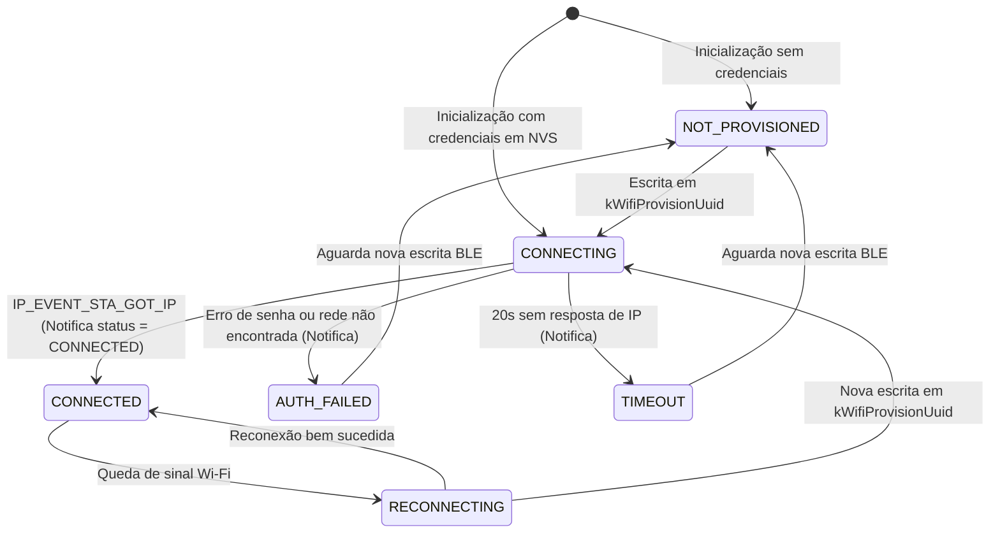

# Spec: Provisionamento de Credenciais Wi-Fi no ESP32 via BLE pelo Aplicativo Cafey (UC-04)

## Summary

Esta especificação define o fluxo de provisionamento de credenciais de rede Wi-Fi (SSID e senha) no módulo microcontrolador ESP32 da cafeteira conectada via Bluetooth Low Energy (BLE), utilizando o aplicativo móvel Cafey (Kotlin Multiplatform / Compose Multiplatform). Ela elimina a necessidade de cabos seriais, arquivos CSV e ferramentas de desenvolvimento (`nvs_partition_gen.py` / `esptool.py`) no processo de configuração inicial do usuário final, conectando o hardware à rede local e vinculando o dispositivo à conta do usuário na API REST (`POST /dispositivos`).

---

## Context

No protótipo inicial do projeto Cafey (marcos FW-17, FW-20 e #169), o provisionamento de credenciais Wi-Fi era realizado de maneira estática em bancada através de gravação na partição NVS (`cafey_wifi`). 

A especificação técnica geral do projeto (`docs/documentacao_backend_pi_2_6/spec-cafeteira-conectada.md`, caso de uso **UC-04**) e a especificação de backend (`docs/documentacao_backend_pi_2_6/spec-backend-v1.2.md`, **Premissa P2**) estabelecem que:
1. O Wi-Fi deve ser provisionado pelo usuário por meio do aplicativo via BLE.
2. Os certificados X.509, chaves privadas de thing e CA raiz do AWS IoT Core permanecem gravados previamente em NVS na montagem do hardware, não trafegando pelo rádio BLE.
3. O ESP32 já anuncia o serviço BLE base `6b3d0001-0b0b-4a3a-9c0e-cafe1a000000` (`BleService`) para comandos locais e proxy de eventos (§6.4 e §6.5).
4. No aplicativo móvel, o formulário de cadastro (`DeviceFormScreen.kt`) atualmente sinaliza que o pareamento automático por Bluetooth será disponibilizado em atualização futura.

---

## Goals

1. Permitir que o usuário final configure a rede Wi-Fi da sua cafeteira utilizando unicamente o smartphone e o aplicativo Cafey.
2. Expor características GATT padronizadas no firmware ESP32 para recepção de credenciais Wi-Fi, leitura do número serial e notificação do status de conexão.
3. Notificar o aplicativo em tempo real sobre o resultado da conexão Wi-Fi do ESP32 (conectando, conectado com IP ou falha de autenticação).
4. Associar automaticamente o identificador serial obtido por BLE no cadastro de dispositivo da API REST (`POST /dispositivos`).
5. Manter a integridade e coexistência contínua entre Wi-Fi STA e BLE no ESP-IDF, preservando o advertising contínuo para o Fallback BLE (UC-06/07) e Proxy de Eventos (UC-14).
6. Preservar a opção de cadastro manual de dispositivo para ambientes sem suporte a BLE (Desktop/Web) ou contingências.

---

## Non-Goals

1. **Provisionamento de chaves e certificados AWS IoT via BLE**: A chave privada do dispositivo e o certificado X.509 do AWS IoT Core nunca trafegam por BLE (garantia de segurança estabelecida na Premissa P2).
2. **Substituição definitiva do formulário manual**: O cadastro manual por digitação de serial permanece disponível como alternativa na UI móvel e como padrão nos targets Desktop e Web.
3. **Escaneamento de redes Wi-Fi pelo ESP32 via BLE**: O ESP32 não realiza varredura de SSIDs para retornar ao app por BLE; o próprio aplicativo móvel identifica a rede conectada ou permite inserção manual do SSID pelo usuário, minimizando consumo de RAM e complexidade de rádio no firmware.
4. **Desativação do rádio BLE após provisionamento**: O serviço BLE não deve ser encerrado após o sucesso do Wi-Fi, pois ele atua como canal permanente de comando local em contingência de rede (§6.4) e proxy de telemetria offline (§6.5).

---

## Users / Personas

- **Proprietário da cafeteira (Mobile)**: Usuário comum que adquiriu a cafeteira e deseja conectá-la ao Wi-Fi residencial de 2.4 GHz e vinculá-la à sua conta pelo smartphone de forma guiada e sem atritos técnicos.
- **Usuário em Plataforma Desktop/Web**: Usuário que cadastra ou gerencia sua cafeteira em computadores onde o hardware BLE não está disponível, utilizando o serial gravado na etiqueta física do aparelho.
- **Desenvolvedor / Suporte**: Necessidade de inspecionar estados claros de conectividade e motivos de falha de rede sem exigir abertura de terminal serial.

---

## Functional Requirements

#### Componente 1: Protocolo BLE & Firmware (ESP32)

### RF-01 - Exposição de Características GATT para Provisionamento e Identificação

**Priority:** Must

**Description:**
O BleService do firmware deve expor três novas características GATT sob o serviço principal `6b3d0001-0b0b-4a3a-9c0e-cafe1a000000`: uma para escrita de credenciais Wi-Fi (`kWifiProvisionUuid`), uma para notificação/leitura de status da rede Wi-Fi (`kWifiStatusUuid`) e uma para leitura de dados de identificação do dispositivo (`kDeviceInfoUuid`).

**Acceptance Criteria:**
- [ ] O serviço BLE do ESP32 registra as três novas características durante a inicialização.
- [ ] A leitura de `kDeviceInfoUuid` retorna payload JSON contendo o identificador serial e versão do firmware.
- [ ] A característica `kWifiStatusUuid` emite notificação BLE com o estado CONNECTING em até 500 ms após o início da conexão.
- [ ] A característica `kWifiStatusUuid` emite notificação BLE com o estado CONNECTED e endereço IP local quando o evento IP obtido for recebido.
- [ ] A característica `kWifiStatusUuid` emite notificação BLE com o estado AUTH_FAILED ou DISCONNECTED em caso de erro na autenticação Wi-Fi ou timeout de 20 s.

**Happy Path:**
1. Cliente BLE conecta à base e lê `kDeviceInfoUuid` para obter o serial da cafeteira.
2. Cliente BLE assina as notificações de `kWifiStatusUuid`.
3. Cliente BLE escreve em `kWifiProvisionUuid` o JSON com SSID e senha.
4. Firmware responde com atualização do status para CONNECTING e posteriormente CONNECTED.

**Alternative Flows:**
- Em caso de payload corrompido, o firmware descarta a escrita e atualiza `kWifiStatusUuid` com INVALID_PAYLOAD.

### RF-02 - Persistência NVS e Tentativa de Conexão no Dispositivo

**Priority:** Must

**Description:**
Ao receber a carga útil na característica `kWifiProvisionUuid`, o firmware deve fazer o parsing dos campos de rede, acionar a rotina de provisionamento do WifiManager, salvar as credenciais no namespace NVS seguro e iniciar a conexão no modo estação STA.

**Acceptance Criteria:**
- [ ] As credenciais recebidas são persistidas de forma atômica no NVS no namespace cafey_wifi.
- [ ] A conexão Wi-Fi prévia é finalizada e uma nova tentativa de associação é iniciada imediatamente.
- [ ] O temporizador de timeout de conexão é fixado em 20 s; expirado esse prazo sem obtenção de IP, o firmware interrompe a tentativa e notifica falha.
- [ ] Em caso de reinicialização posterior, o ESP32 utiliza as credenciais persistidas automaticamente para reconectar.

**Happy Path:**
1. Firmware recebe comando de escrita em `kWifiProvisionUuid`.
2. Invoca `WifiManager::provision`.
3. NVS armazena SSID e senha.
4. Driver Wi-Fi do ESP-IDF associa e obtém endereço IP via DHCP.
5. Handler de evento dispara notificação de sucesso via status BLE.

#### Componente 2: Cliente BLE & Escaneamento (KMP Shared / Core)

### RF-03 - Descoberta e Pareamento BLE

**Priority:** Must

**Description:**
O módulo compartilhado `apps/shared` deve implementar rotinas de varredura de periféricos BLE, filtrando dispositivos que anunciem o Service UUID do Cafey, estabelecendo conexão GATT e lendo a identificação da máquina.

**Acceptance Criteria:**
- [ ] Scanner BLE filtra os anúncios pelo Service UUID do projeto Cafey `6b3d0001-0b0b-4a3a-9c0e-cafe1a000000`.
- [ ] Dispositivos encontrados são mapeados com identificador local, nome de anúncio e RSSI.
- [ ] Ao selecionar um dispositivo, estabelece conexão GATT em até 10 s.
- [ ] Efetua a leitura do serial único da cafeteira via característica de identificação.
- [ ] Trata desconexões inesperadas ou falha no estabelecimento de conexão com exceção tipada de erro de conexão BLE.

### RF-04 - Envio de Credenciais Wi-Fi e Escuta de Status

**Priority:** Must

**Description:**
O cliente BLE deve habilitar as notificações da característica de status Wi-Fi, formatar os dados de rede fornecidos em JSON e gravar na característica de provisionamento, reportando as transições de estado para a camada de apresentação.

**Acceptance Criteria:**
- [ ] Converte SSID e senha para bytes UTF-8 no formato JSON estruturado.
- [ ] Envia a mensagem via escrita GATT em menos de 1500 ms.
- [ ] Observa as notificações assíncronas de status por meio de fluxo reativo de dados.
- [ ] Encerra a escuta e sinaliza sucesso assim que o status CONNECTED for recebido com IP válido.
- [ ] Reporta erro com mensagem amigável caso receba AUTH_FAILED ou se ocorrer timeout de 30 s no cliente.

#### Componente 3: Fluxo e Experiência do Usuário (Apps UI/UX)

### RF-05 - Assistente Guiado de Pareamento e Cadastro na UI

**Priority:** Must

**Description:**
O aplicativo deve fornecer um fluxo visual para o cadastro de novos dispositivos, integrando solicitação de permissões de rádio, escaneamento, configuração de rede Wi-Fi e cadastro final na API do backend.

**Acceptance Criteria:**
- [ ] Na tela inicial de adição de dispositivo, exibe botão destacado para buscar cafeteira via Bluetooth.
- [ ] Solicita ao sistema operacional as permissões necessárias para escaneamento e conexão BLE no Android.
- [ ] Exibe lista de dispositivos Cafey detectados com indicador de força de sinal em tempo real.
- [ ] Tela de credenciais permite selecionar ou digitar o SSID e inserir a senha com controle de visibilidade.
- [ ] Apresenta tela informativa de progresso durante a tentativa de conexão da cafeteira à rede Wi-Fi.
- [ ] Ao confirmar a conexão da cafeteira com sucesso, avança preenchendo o serial obtido na chamada de cadastro POST /dispositivos, solicitando apenas o apelido ao usuário.

**Happy Path:**
1. Usuário toca em adicionar cafeteira no aplicativo móvel.
2. Usuário concede permissão de Bluetooth.
3. App exibe cafeteira encontrada nas proximidades.
4. Usuário conecta e insere a senha da rede Wi-Fi local de 2.4 GHz.
5. App envia credenciais e acompanha o status até confirmação de conexão.
6. Usuário define apelido e conclui o cadastro com sucesso na API REST.

### RF-06 - Contingência e Cadastro Manual

**Priority:** Should

**Description:**
Manter a rota e a interface de cadastro manual de dispositivo como alternativa disponível para o usuário, permitindo o cadastro por digitação manual do serial em plataformas sem BLE (Desktop e Web) ou quando o dispositivo físico estiver fora do alcance Bluetooth.

**Acceptance Criteria:**
- [ ] Um botão para configurar manualmente com serial é exibido na tela de busca BLE.
- [ ] Em plataformas onde o cliente BLE não é suportado (Web e Desktop), o formulário manual é apresentado diretamente.
- [ ] O fluxo manual preserva os campos de configuração existentes: serial, fuso horário, duração de preparo e limiar de descalcificação.

---

## Non-Functional Requirements

### RNF-01 - Desempenho e Latência de Comunicação

**Priority:** Must

**Description:**
Critérios de desempenho temporal na comunicação BLE e conexão Wi-Fi entre o hardware e o aplicativo móvel.

**Acceptance Criteria:**
- [ ] A descoberta da base BLE em ambiente sem obstruções a até 3 metros deve ocorrer em menos de 5 s.
- [ ] A transmissão do payload de credenciais não deve exceder 1500 ms de duração.
- [ ] A resposta de sucesso ou falha da conexão Wi-Fi do ESP32 deve ser notificada ao aplicativo em até 20 s após o envio.

### RNF-02 - Segurança de Credenciais e Isolamento de Chaves

**Priority:** Must

**Description:**
Garantias de proteção das credenciais em trânsito e segregação das chaves privadas da nuvem.

**Acceptance Criteria:**
- [ ] A senha da rede Wi-Fi não deve ser registrada em texto plano nos logs de depuração do aplicativo ou console serial.
- [ ] As credenciais X.509 da AWS IoT permanecem isoladas na partição NVS e não possuem nenhuma interface de leitura ou exportação via BLE conforme Premissa P2.
- [ ] O tamanho dos campos de SSID e senha é validado no firmware para evitar estouro de memória (SSID com até 32 bytes e senha com até 64 bytes).

### RNF-03 - Coexistência Wi-Fi e Bluetooth no Firmware

**Priority:** Must

**Description:**
Estabilidade de hardware e operação contínua do rádio de comunicação no ESP-IDF.

**Acceptance Criteria:**
- [ ] A inicialização do rádio Wi-Fi concomitante ao Bluetooth deve operar sem falhas de alocação de memória no ESP-IDF com coexistência ativa.
- [ ] O advertising do BLE do ESP32 permanece operante após o término do provisionamento para suportar o fallback de comando local e proxy de eventos pendentes.

---

## Behavior / States

### Máquina de Estados de Provisionamento Wi-Fi no ESP32



---

## Data

### Payload de Provisionamento (BLE Write: `kWifiProvisionUuid`)
```json
{
  "ssid": "NomeDaRedeWiFi",
  "password": "SenhaDaRede123"
}
```

### Payload de Status Wi-Fi (BLE Read / Notify: `kWifiStatusUuid`)
```json
{
  "state": "CONNECTED",
  "ip": "192.168.1.150",
  "error": null
}
```
*Valores possíveis de `state`:* `DISCONNECTED`, `CONNECTING`, `CONNECTED`, `AUTH_FAILED`, `TIMEOUT`, `INVALID_PAYLOAD`.

### Payload de Identificação do Dispositivo (BLE Read: `kDeviceInfoUuid`)
```json
{
  "serial": "cafey-proto-01",
  "firmware": "1.0.0",
  "model": "ESP32-WROOM-32"
}
```

---

## Integrations / Dependencies

- **ESP-IDF (`firmware/`)**:
  - `esp_wifi.h` e `esp_event.h` para gerenciamento da interface STA.
  - NimBLE stack (`esp_nimble_hci` e `nimble/nimble_port.h`) provida pelo wrapper `IBleServer`.
  - NVS flash (`nvs_flash.h`) para persistência de credenciais no namespace `cafey_wifi`.
- **Kotlin Multiplatform (`apps/`)**:
  - Biblioteca cliente BLE multiplataforma ou interfaces nativas Android/iOS.
  - Permissões do Android Manifest (`BLUETOOTH_SCAN`, `BLUETOOTH_CONNECT`, `ACCESS_FINE_LOCATION`).
  - `DeviceApi` (`POST /api/v1/dispositivos`) para criação do vínculo na nuvem.

---

## Edge Cases

1. **Rede Wi-Fi com senha incorreta**: O ESP32 emite evento de desconexão com código de falha de autenticação. O status `AUTH_FAILED` é notificado via BLE. O app exibe mensagem clara: *"Senha da rede Wi-Fi incorreta. Verifique os dados e tente novamente"*, mantendo o usuário na tela de digitação de senha sem fechar o assistente.
2. **Rede Wi-Fi de 5 GHz selecionada**: O ESP32 suporta apenas redes na faixa de 2.4 GHz. Caso tente conectar em 5 GHz, haverá timeout de beacon. O aplicativo deve orientar textualmente que a rede precisa ser 2.4 GHz.
3. **Queda da conexão BLE durante o provisionamento**: Se o celular se afastar durante a escrita, a transação falha. O ESP32 não aplica credenciais parciais. O aplicativo informa perda de conexão e oferece botão para tentar reconectar.
4. **Cafeteira já vinculada a outro proprietário**: Caso o usuário consiga conectar por BLE e configurar o Wi-Fi, mas o serial já esteja registrado na API REST para outro usuário, o backend responderá com conflito `409 Conflict`. O aplicativo trata o erro informando que o dispositivo já pertence a outra conta.
5. **SSID com caracteres especiais e espaços**: O parser JSON e a camada de rede do ESP32 devem aceitar caracteres UTF-8 e espaços sem truncar a string de dados.

---

## Error Handling

| Origem do Erro | Condição | Ação do Sistema | Feedback ao Usuário |
| :--- | :--- | :--- | :--- |
| **BLE Scan** | Bluetooth desativado no smartphone | App solicita ativação do adaptador via intent do SO | Diálogo: "Ative o Bluetooth para localizar sua cafeteira" |
| **BLE Scan** | Permissão negada pelo usuário | App não consegue escanear periféricos | Aviso com botão para abrir Configurações do app no SO |
| **BLE Connect** | Dispositivo fora de alcance ou ocupado | Tentativa de conexão GATT excede 10 s | "Não foi possível conectar à cafeteira. Aproxime o celular" |
| **Wi-Fi Firmware** | Senha inválida no roteador | Notificação `AUTH_FAILED` via BLE | "Falha de autenticação. A senha do Wi-Fi está correta?" |
| **Wi-Fi Firmware** | Roteador fora do alcance | Timeout de 20 s no ESP32 (`TIMEOUT`) | "Não foi possível encontrar a rede Wi-Fi. Verifique o sinal" |
| **REST API** | Falha de rede no celular no `POST /dispositivos` | HTTP timeout ou erro de rede | "Wi-Fi configurado! Mas houve falha ao registrar na nuvem. Toque para tentar registrar novamente" |

---

## Security / Privacy

1. **Privilégio Mínimo de Chaves**: A chave privada RSA da cafeteira nunca é exposta ou enviada pelo rádio BLE. Ela permanece protegida na memória NVS configurada em fábrica.
2. **Ciclo de Vida de Credenciais na Memória**: A senha da rede Wi-Fi informada pelo usuário é armazenada temporariamente apenas em memória de escopo do ViewModel e enviada pelo canal BLE, sem log em texto plano.
3. **Restrição de Acesso de Escrita**: As características de escrita aceitam comandos apenas com validação de payload; valores malformatados são imediatamente rejeitados sem alterar a memória flash.

---

## Rollout

- **Fase 1 (Firmware)**: Implementação das características GATT no `BleService` e integração de callback com `WifiManager::provision`. Testes unitários com fakes de `IBleServer`.
- **Fase 2 (Shared Core)**: Extensão do `BleClient` e models de provisionamento no KMP, garantindo cobertura de testes unitários com fakes de transporte BLE.
- **Fase 3 (UI Android)**: Implementação das telas do assistente de pareamento no target Android com gestão de permissões de sistema.
- **Fase 4 (Integração E2E)**: Validação em bancada conectando smartphone Android físico ao ESP32, provisionando rede residencial e conferindo aparição online no AWS IoT Core e backend.

---

## Open Questions

- *Nenhuma questão em aberto*: Todas as decisões de escopo foram confirmadas e integradas à especificação.

---

## Decisions

1. **ADR-P2**: Chaves privadas AWS IoT não trafegam por BLE; provisionamento BLE limita-se a credenciais Wi-Fi (SSID e senha).
2. **ADR-BLE-SERIAL**: O serial único do ESP32 é exposto via característica de leitura BLE (`kDeviceInfoUuid`), permitindo preenchimento automático no cadastro REST sem digitação manual pelo usuário.
3. **ADR-FALLBACK-MANUAL**: O cadastro manual por formulário tradicional é mantido como contingência e como padrão para plataformas Desktop e Web.

---

## References

- Caso de uso UC-04: `docs/documentacao_backend_pi_2_6/spec-cafeteira-conectada.md` §8.1.
- Fallback e Proxy BLE: `docs/documentacao_backend_pi_2_6/spec-cafeteira-conectada.md` §6.4 e §6.5.
- Premissa P2 de Provisionamento: `docs/documentacao_backend_pi_2_6/spec-backend-v1.2.md` §2.
- Código do Firmware BLE: `firmware/main/app/ble_service.hpp`.
- Código do WifiManager: `firmware/main/core/wifi_manager.hpp`.
- Tela atual do aplicativo: `apps/shared/src/commonMain/kotlin/br/com/tavaressan/cafey/shared/ui/device/DeviceFormScreen.kt`.

---

## Revision History

| Data | Autor | Mudança |
| :--- | :--- | :--- |
| 2026-10-21 | Antigravity / Vetor | Rascunho inicial gerado por /vetor:spec para Issue #249 (UC-04) |
