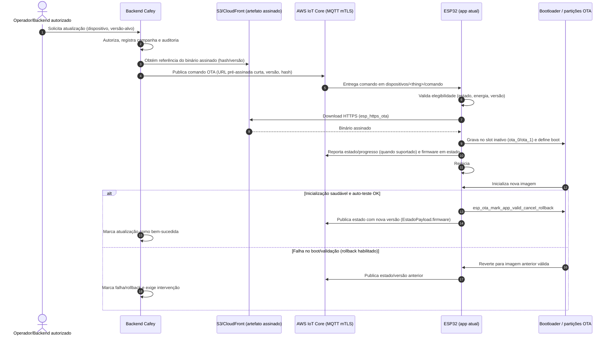

# Spike: Avaliação e planejamento de atualização OTA do firmware do ESP32 (#320)

**Status:** Concluído (avaliação, sem implementação)  
**Data:** 11/11/2026  
**Issue:** #320 `[SPIKE] Avaliar e planejar atualização OTA do firmware do ESP32`  
**Tipo:** spike técnico — **não implementar OTA nesta etapa**; a gravação manual por USB (#309) permanece suficiente para o protótipo.  
**Dependências relacionadas:** #309 (gravação manual/USB), #277 (Flash Encryption, NVS Encryption e Secure Boot v2 em placa reserva), #126 (risco de migração do layout da NVS após atualização), #274.

---

## 1. Contexto e objetivo

O firmware do Cafey roda em **ESP32 (ESP-IDF, C++17)**, conecta-se ao **AWS IoT Core (sa-east-1)** via **MQTT com mTLS** e expõe preparo, agendamentos offline e telemetria. Hoje não existe mecanismo de atualização remota: novas versões exigem retirar o módulo e gravar por USB (procedimento de #309).

Este documento avalia a viabilidade técnica de OTA (Over-The-Air) no estado atual do projeto, compara alternativas de distribuição/orquestração, descreve a mudança de partições necessária (**sem aplicá-la**) e recomenda adotar, adiar ou descartar a funcionalidade, com justificativa, arquitetura, riscos e esforço.

---

## 2. Dados levantados no repositório (medidos, sem chute)

### 2.1 Flash e binário atual

**Configuração de flash (`firmware/sdkconfig.defaults`):**

```ini
CONFIG_IDF_TARGET="esp32"
CONFIG_ESPTOOLPY_FLASHSIZE_4MB=y
CONFIG_ESPTOOLPY_FLASHSIZE="4MB"
CONFIG_PARTITION_TABLE_CUSTOM=y
CONFIG_PARTITION_TABLE_CUSTOM_FILENAME="partitions.csv"
CONFIG_PARTITION_TABLE_FILENAME="partitions.csv"
```

Não há `firmware/sdkconfig` versionado no repositório; o alvo e o tamanho de flash efetivos para o build partem dos defaults acima.

**Comando usado para medir o binário:**

```bash
source ~/.espressif/v5.3/esp-idf/export.sh && cd firmware && idf.py build && idf.py size
```

**Números medidos (ESP-IDF v5.3, target `esp32`, build local desta worktree):**

| Medida | Valor |
|---|---|
| Binário da aplicação (`build/cafey_firmware.bin`) | **0x121220 bytes = 1.184.288 bytes (~1,13 MiB)** |
| Menor partição de app disponível (atual) | **0x200000 bytes (2 MiB, `factory`)** |
| Folga na partição de app atual | **0x0DEDE0 bytes (~912 KiB, 44%)** |
| Imagem total (`idf.py size`) | **1.184.172 bytes** (`.bin` pode ser maior por padding) |
| Flash Code `.text` | 864.790 bytes |
| Flash Data (`.rodata` + `.appdesc`) | 165.476 bytes |
| IRAM usado | 129.426 / 131.072 bytes (98,74%) |
| DRAM usado | 52.344 / 124.580 bytes (42,02%) |
| Bootloader | 0x68E0 bytes (~26,8 KiB), 6% livre |

> Observação: IRAM está muito próxima do limite (98,74%). Isso não impede OTA em si, mas é uma restrição relevante para evolução do firmware e para qualquer código adicional de atualização/validação que execute em contextos sensíveis a IRAM.

### 2.2 Tabela de partições atual (`firmware/partitions.csv`)

```csv
# Name,     Type,  SubType,  Offset,  Size,   Flags
nvs,        data,  nvs,      0x9000,  0x6000,
phy_init,   data,  phy,      0xf000,  0x1000,
factory,    app,   factory,  0x10000, 2M,
storage,    data,  nvs,      ,        1M,
nvs_keys,   data,  nvs_keys, ,        0x1000, encrypted
```

**Mapa efetivo aproximado (flash de 4 MiB = 0x400000):**

| Partição | Offset | Tamanho | Fim (aprox.) | Observação |
|---|---:|---:|---:|---|
| (bootloader/áreas reservadas) | 0x0000 | — | 0x9000 | antes da tabela de dados |
| `nvs` | 0x9000 | 0x6000 (24 KiB) | 0xF000 | NVS padrão |
| `phy_init` | 0xF000 | 0x1000 (4 KiB) | 0x10000 | calibração PHY |
| `factory` | 0x10000 | 0x200000 (2 MiB) | 0x210000 | app único atual |
| `storage` | 0x210000 | 0x100000 (1 MiB) | 0x310000 | NVS de aplicação (agendamentos, fila de eventos, credenciais etc., conforme uso do projeto) |
| `nvs_keys` | 0x310000 | 0x1000 (4 KiB) | 0x311000 | chaves de NVS criptografada (`encrypted`) |
| **espaço livre não particionado** | 0x311000 | **0xEF000 (~956 KiB)** | 0x400000 | dentro da flash de 4 MiB, porém fora da tabela atual |

Conclusão: **não há `otadata`, nem `ota_0`, nem `ota_1`**. O particionamento atual é de app único (`factory`) e, embora a soma declarada caiba em 4 MiB com folga não particionada, ele **não suporta OTA A/B** sem replanejamento.

### 2.3 Interação com segurança (`firmware/sdkconfig.security`, #277)

O perfil de produção (`sdkconfig.security`, usado com `-D SDKCONFIG_DEFAULTS="sdkconfig.defaults;sdkconfig.security"` em placa reserva) define:

- **Secure Boot v2:** `CONFIG_SECURE_BOOT=y`, `CONFIG_SECURE_BOOT_V2_ENABLED=y`, `CONFIG_SECURE_BOOT_BUILD_SIGNED_BINARIES=y`, chave de assinatura `secure_boot_signing_key.pem`, `CONFIG_SECURE_BOOT_ENABLE_AGGRESSIVE_REVOCATION=y`.
- **Flash Encryption:** `CONFIG_SECURE_FLASH_ENC_ENABLED=y`, `CONFIG_SECURE_FLASH_ENCRYPTION_MODE_RELEASE=y`, `CONFIG_SECURE_FLASH_CHECK_ENC_EN_IN_APP=y`.
- **NVS Encryption:** `CONFIG_NVS_ENCRYPTION=y` (depende de `nvs_keys`).
- **Endurecimento:** `CONFIG_SECURE_DISABLE_ROM_DL_MODE=y`.

**Implicações para OTA (ESP-IDF v5.3, APIs `esp_https_ota` / `esp_ota_*`):**

- **Assinatura das imagens OTA:** com Secure Boot v2 ativo, toda imagem de app gravada em um slot OTA deve ser **assinada** com a chave privada correspondente à chave pública confiável do dispositivo (e compatível com o esquema de revogação/aggressive revocation configurado). O bootloader rejeita imagens sem assinatura válida; distribuir binários não assinados inviabiliza a atualização.
- **Flash Encryption:** em modo release, o conteúdo gravado na flash de app é criptografado conforme as regras do ESP-IDF. O fluxo de download OTA deve usar o caminho suportado pelo componente de OTA do IDF para que a escrita no slot respeite a criptografia/hardware do dispositivo.
- **Chaves e segredo operacional:** a chave privada de Secure Boot **nunca** deve sair do ambiente de build/assinatura controlado; o pipeline de release precisa assinar artefatos OTA. A NVS Encryption já exige `nvs_keys` (preservada na proposta abaixo).
- **Irreversibilidade:** eFuses de Secure Boot/Flash Encryption são queimados de forma permanente. Qualquer validação de OTA em conjunto com segurança deve ocorrer **apenas em placa reserva** (alinhado a #277 e `sdkconfig.security`).

### 2.4 Como a versão do firmware chega hoje ao backend e o que falta persistir

**Fluxo atual (verificado no código):**

- O backend recebe estado via MQTT no `MqttClientService` e desserializa `EstadoPayload` (`backend/.../mqtt/MqttPayloads.kt`), que contém `estado`, `desde` e `firmware: String?`.
- `MqttIngestionService.processarEstado` atualiza o dispositivo e, quando presente, persiste o campo: `payload.firmware?.let { dispositivo.firmware = it }`.
- A entidade `Dispositivo` possui `firmware` (migração V12, coluna `VARCHAR(100)`); DTOs de diagnóstico expõem `firmware` (`DeviceDto`/respostas de dispositivo e diagnóstico).

**O que falta para um ciclo OTA completo (além de "saber a versão atual"):**

- **Rastreamento de rollout/campanha:** qual versão-alvo foi ofertada a qual dispositivo, quando, por quem (autorização/auditoria) e com qual resultado.
- **Estado do processo OTA no backend:** pendente, baixando (se reportado), aguardando reboot, verificação pós-boot, sucesso, falha, rollback — hoje inexistente.
- **Identidade do artefato:** hash/assinatura/URL (ou jobId) do binário distribuído, tamanho e metadados mínimos para reconciliação.
- **Política de elegibilidade/downgrade:** regras explícitas (permitir/bloquear downgrade, janelas de manutenção, pré-condições de conectividade/bateria se aplicável).
- **Vínculo com slot/boot:** opcionalmente registrar se o dispositivo confirmou a nova imagem (`esp_ota_mark_app_valid_cancel_rollback`) ou reverteu, para observabilidade operacional.

Ou seja: o backend **já persiste a versão reportada no estado**, mas **não persiste nem orquestra o ciclo de atualização OTA**.

---

## 3. Mudança de partições necessária (proposta, **sem aplicar**)

### 3.1 Requisitos

- Substituir o esquema de app único (`factory`) por **dois slots OTA** (`ota_0`, `ota_1`) + **`otadata`**.
- Manter **`storage`** (dados de aplicação/NVS) e **`nvs_keys`** (obrigatória com NVS Encryption, `encrypted`).
- Cada slot deve comportar o binário atual (**~1,13 MiB**) com margem de crescimento.
- Continuar cabendo na flash de **4 MiB** configurada.

### 3.2 Proposta de layout A/B (compatível com 4 MiB)

A proposta abaixo preserva NVS/PHY, introduz `otadata`, cria dois slots simétricos e reduz `storage` de 1 MiB para **512 KiB** para viabilizar dois apps de ~1,5 MiB:

```csv
# Proposta OTA A/B (NÃO APLICADA) — flash 4MB
# Name,     Type,  SubType,  Offset,   Size,     Flags
nvs,        data,  nvs,      0x9000,   0x6000,
otadata,    data,  ota,      0xF000,   0x2000,
phy_init,   data,  phy,      0x11000,  0x1000,
ota_0,      app,   ota_0,    0x20000,  0x180000,
ota_1,      app,   ota_1,    0x1A0000, 0x180000,
storage,    data,  nvs,      0x320000, 0x80000,
nvs_keys,   data,  nvs_keys, 0x3A0000, 0x1000,   encrypted
```

**Verificação de encaixe:**

| Partição | Offset | Tamanho | Fim |
|---|---:|---:|---:|
| `nvs` | 0x9000 | 24 KiB | 0x0F000 |
| `otadata` | 0xF000 | 8 KiB | 0x11000 |
| `phy_init` | 0x11000 | 4 KiB | 0x12000 |
| (alinhamento até `ota_0`) | 0x12000 | 56 KiB | 0x20000 |
| `ota_0` | 0x20000 | 1,5 MiB (0x180000) | 0x1A0000 |
| `ota_1` | 0x1A0000 | 1,5 MiB (0x180000) | 0x320000 |
| `storage` | 0x320000 | 512 KiB (0x80000) | 0x3A0000 |
| `nvs_keys` | 0x3A0000 | 4 KiB | 0x3A1000 |
| **livre** | 0x3A1000 | ~380 KiB | 0x400000 |

- Cada slot OTA (**1,5 MiB**) comporta o binário atual (**~1,13 MiB**) com ~**344 KiB** de margem (~22% do slot), suficiente para crescimento moderado, mas exigindo disciplina de tamanho.
- `nvs_keys` permanece presente e `encrypted`.
- `storage` **encolhe de 1 MiB para 512 KiB**: antes de aplicar, é necessário medir o uso real (namespaces/chaves, fila de eventos offline, agendamentos, credenciais) e validar que 512 KiB são suficientes com margem; se não forem, alternativas são (a) reduzir mais os slots (apertando margem de app), (b) aceitar flash maior no hardware futuro, ou (c) adiar OTA.
- A troca de `factory` para `ota_0/ota_1` **invalida o layout anterior**: atualização em campo exigiria estratégia de migração/regravação completa (bootloader/partições/app/dados), com risco operacional alto em dispositivos já implantados (ver riscos e #126).

> **Nenhuma alteração foi feita** em `firmware/partitions.csv`, `sdkconfig*` ou código; este é apenas o desenho proposto.

---

## 4. Alternativas avaliadas

### 4.1 `esp_https_ota` com URL pré-assinada (S3/CloudFront)

**Descrição:** o backend (ou serviço autorizado) gera uma **URL pré-assinada** de curta duração para um artefato assinado armazenado em S3 (opcionalmente distribuído via CloudFront). A placa baixa o binário por HTTPS e grava no slot inativo usando o componente **`esp_https_ota`** do ESP-IDF (APIs como `esp_https_ota`, `esp_https_ota_begin/perform/finish`, integradas ao subsistema `esp_ota_*`).

| Critério | Avaliação |
|---|---|
| **Segurança** | HTTPS no transporte; autenticidade do firmware garantida por **Secure Boot v2** (assinatura da imagem) — requisito crítico. A URL pré-assinada deve ter TTL curto, escopo mínimo (objeto/versão específica) e ser entregue apenas a dispositivo autenticado/autorizado. Exige gestão segura de certificados CA/TLS no dispositivo. |
| **Esforço** | **Médio.** Implementar cliente OTA no firmware, endpoint/fluxo no backend para autorizar e emitir URL, armazenamento/versionamento de artefatos, e UI/operacao de disparo. Menor acoplamento a serviços gerenciados de jobs. |
| **Impacto nas políticas IoT** | **Baixo a médio.** O disparo pode ser um comando/atributo no canal MQTT já existente (tópico de comando/controlado por política atual, desde que o payload/schema seja definido) contendo metadados e a URL; não exige necessariamente novas permissões IoT além das já usadas para comando/estado, mas exige cuidado para não vazar URLs e para autorizar quem pode comandar atualização. |
| **Dependências** | S3 (e opcionalmente CloudFront), backend capaz de assinar/emitir URLs, pipeline de build que produza e publique binário assinado, conectividade Wi-Fi/HTTPS de saída da placa. |

### 4.2 AWS IoT Jobs

**Descrição:** orquestração de rollout via **AWS IoT Jobs** (documentos de job entregues ao dispositivo), com a placa executando o download/instalação (tipicamente ainda via HTTPS/`esp_https_ota` para o artefato, ou conforme desenho) e reportando progresso/status do job.

| Critério | Avaliação |
|---|---|
| **Segurança** | Beneficia-se de controle de acesso IAM/IoT para criar/gerenciar jobs e de comunicação pelo canal autenticado do dispositivo; ainda depende de **assinatura da imagem** (Secure Boot v2) e de transporte seguro do artefato. Reduz risco de "URL solta" se o artefato for mediado corretamente. |
| **Esforço** | **Médio a alto.** Além do cliente OTA, requer integração com APIs/fluxo de Jobs no dispositivo e no backend/operacao (criação de jobs, documentos, acompanhamento, retries, timeout). |
| **Impacto nas políticas IoT** | **Médio a alto.** Exige permissões adicionais de IoT Jobs nos certificados/políticas do dispositivo (tópicos/ações de Jobs, conforme modelo do serviço) e possíveis ajustes na política do backend/operador. A política de dispositivo atual (`${iot:Connection.Thing.ThingName}`) precisaria ser revisada/versionada (lembrando a restrição operacional de versões de política já observada no projeto). |
| **Dependências** | AWS IoT Jobs, definição de documento de job, observabilidade de execução, e (em geral) armazenamento do artefato (S3/URL) — Jobs orquestra, mas não substitui a validação criptográfica no boot. |

### 4.3 Adiar (gravação manual por USB, #309)

**Descrição:** manter o fluxo atual de atualização física, sem slots OTA nem orquestração remota.

| Critério | Avaliação |
|---|---|
| **Segurança** | Superfície remota de atualização inexistente; mantém o modelo já validado (#277/#309). Risco operacional concentrado no acesso físico/procedimento manual. |
| **Esforço** | **Nulo** de implementação OTA (custo recorrente apenas operacional/manutenção em bancada). |
| **Impacto nas políticas IoT** | **Nenhum.** |
| **Dependências** | Acesso físico ao dispositivo e procedimento de gravação. |

### 4.4 Comparação resumida

| Alternativa | Segurança | Esforço | Impacto políticas IoT | Dependências principais | Adequação ao estágio atual |
|---|---|---:|---|---|---|
| `esp_https_ota` + URL pré-assinada | Alta, se imagem assinada + URL curta + TLS correto | Médio | Baixo–médio | S3/CloudFront, backend, pipeline de assinatura | Boa evolução incremental |
| AWS IoT Jobs | Alta, com boa orquestração/auditoria | Médio–alto | Médio–alto | IoT Jobs, revisão de políticas, storage | Melhor para frota, maior custo inicial |
| Adiar (USB, #309) | Modelo atual preservado | Nenhum | Nenhum | Acesso físico | **Mais aderente ao protótipo atual** |

---

## 5. Recomendação (clara)

**Recomendação: ADIAR a adoção de OTA neste momento (manter gravação manual por USB, #309), mas preparar o terreno em documentação/decisões para uma adoção futura incremental via `esp_https_ota` com URL pré-assinada quando houver necessidade real de atualização remota em campo.**

**Justificativa (uma frase):** com flash de 4 MiB, binário atual de ~1,13 MiB e layout `factory` sem `otadata`/slots A/B, viabilizar OTA exige reprojetar partições (reduzindo `storage`), introduzir pipeline de assinatura compatível com Secure Boot v2 e orquestração/auditoria no backend — complexidade e risco desproporcionais ao estágio de protótipo, em que a atualização física permanece suficiente.

---

## 6. Arquitetura proposta (para adoção futura)

Quando a adoção for priorizada, a arquitetura recomendada é **`esp_https_ota` + artefato assinado em S3 com URL pré-assinada**, disparo autorizado pelo backend e validação de boot com rollback:

1. **Pipeline de release:** build reprodutível → assinatura da imagem (Secure Boot v2) → publicação do binário versionado em S3 (hash/metadados).
2. **Controle no backend:** registra versão-alvo, autorização do disparo e auditoria; expõe/gera URL pré-assinada de TTL curto para dispositivo elegível e autenticado.
3. **Canal de comando:** notificação via MQTT (tópico de comando existente, payload versionado) contendo versão, hash/tamanho e URL (ou referência segura). O backend já persiste `firmware` reportado em `EstadoPayload.firmware`; deve evoluir para rastrear campanha/estado do rollout.
4. **Dispositivo (ESP-IDF v5.3):** recebe comando, baixa via **`esp_https_ota`**, grava no slot inativo (`ota_0`/`ota_1`), seleciona boot e reinicia. No primeiro boot saudável da nova imagem, confirma com **`esp_ota_mark_app_valid_cancel_rollback`** (quando rollback estiver habilitado).
5. **Segurança:** imagem assinada (Secure Boot v2), transporte HTTPS, URL efêmera, políticas IoT mínimas; em produção, operar com `sdkconfig.security` validado em placa reserva.

**Observação:** AWS IoT Jobs permanece uma evolução natural se a frota crescer e for necessário gerenciamento robusto de campanhas, retries e relatórios padronizados, ao custo de maior impacto em políticas e integração.

### 6.1 Fluxo de atualização (diagrama de sequência)



---

## 7. Riscos e limitações

| Risco/limitação | Impacto | Mitigação proposta |
|---|---|---|
| **Queda de energia no meio do download/gravação** | Imagem parcial no slot inativo; necessidade de robustez do fluxo OTA | Usar APIs `esp_https_ota`/`esp_ota_*` com gravação no slot inativo e só alternar boot após finalização válida; suportar retomada/novo disparo. |
| **Falha após reboot (nova imagem inválida em runtime)** | Dispositivo indisponível se não houver rollback | Habilitar **`CONFIG_BOOTLOADER_APP_ROLLBACK_ENABLE`**, executar auto-teste mínimo e confirmar com **`esp_ota_mark_app_valid_cancel_rollback`**; sem confirmação, bootloader reverte para app anterior. |
| **Migração de layout da NVS (#126)** | Perda/incompatibilidade de dados (credenciais, agendamentos, chaves lógicas) após mudança de partições/versões | Planejar migração explícita de chaves/versão de esquema, janela de manutenção e procedimento de recuperação; validar exaustivamente em placa reserva antes de campo. |
| **Agendamentos offline e operação durante preparo** | Atualizar em momento inadequado pode interromper preparo ou degradar experiência offline | Definir política de janela de atualização (ex.: não atualizar durante `Brewing`/preparo ativo), exigir condições de conectividade estável e consentimento operacional. |
| **Flash de 4 MiB e crescimento do binário** | Slots de 1,5 MiB deixam margem finita (~22% hoje); IRAM já em 98,74% | Monitorar tamanho/IRAM em CI, impor orçamento, e considerar hardware com flash maior se OTA e novas features forem requisitos. |
| **Encolhimento de `storage` (1 MiB → 512 KiB)** | Risco de exaustão para fila offline/agendamentos/credenciais | Medir uso real antes de aplicar; ajustar layout ou adiar. |
| **Compatibilidade com Secure Boot v2 e Flash Encryption (#277)** | Imagens não assinadas/incompatíveis não inicializam; erros podem "tijolar" logicamente sem acesso físico | Pipeline de assinatura controlado, testes em placa reserva com `sdkconfig.security`, versionamento de chaves/revogação alinhado a `CONFIG_SECURE_BOOT_ENABLE_AGGRESSIVE_REVOCATION`. |
| **Políticas IoT e credenciais** | Ampliação de superfície (Jobs ou novos fluxos) pode exigir mais permissões | Princípio do menor privilégio, revisão/versionamento manual de políticas conforme prática do projeto. |
| **Dispositivos já implantados com layout `factory`** | Migração remota de tabela de partições é arriscada/impraticável | Tratar mudança de particionamento como operação que pode exigir reprovisionamento físico; planejar antes de escalar frota. |

---

## 8. Estimativa de esforço (adoção futura, ordem de grandeza)

| Frente | Escopo | Estimativa |
|---|---|---:|
| **Particionamento e boot** | Novo `partitions.csv` (A/B + `otadata`), validação de `storage`/`nvs_keys`, configuração de rollback (`CONFIG_BOOTLOADER_APP_ROLLBACK_ENABLE`) e testes de boot | 1,5–2,5 dias |
| **Firmware (cliente OTA)** | Integração `esp_https_ota`/`esp_ota_*`, comando de atualização, validação de versão/hash, auto-teste e `esp_ota_mark_app_valid_cancel_rollback`, tratamento de estados/erros | 3–5 dias |
| **Segurança e pipeline** | Assinatura de artefatos compatível com Secure Boot v2, publicação em S3, gestão de metadados/hash, validação em placa reserva com `sdkconfig.security` | 2–4 dias |
| **Backend e operação** | Modelo de campanha/estado de OTA, autorização, emissão de URL pré-assinada, auditoria, evolução do uso de `EstadoPayload.firmware` para rastreabilidade | 3–5 dias |
| **Testes e endurecimento** | Queda de energia simulada, rollback, migração NVS (#126), cenários offline/agendamento, ensaios ponta a ponta | 3–5 dias |
| **Total (referência)** | Implementação incremental ponta a ponta (MVP seguro) | **~13–22 dias úteis** |

> Estimativa depende de: medição real do uso de `storage`, disponibilidade de placa(s) reserva para testes com segurança habilitada, e da decisão entre comando simples (URL pré-assinada) vs. AWS IoT Jobs.

---

## 9. Referências do ESP-IDF v5.3 (por nome de seção/API)

- **API de atualização OTA:** componente **OTA** / **`esp_https_ota`** (funções `esp_https_ota`, `esp_https_ota_begin`, `esp_https_ota_perform`, `esp_https_ota_finish`, e configuração associada).
- **Subpartições e slots:** APIs **`esp_ota_*`** — seleção e manipulação de partições OTA (`esp_ota_get_next_update_partition`, `esp_ota_set_boot_partition`, `esp_ota_get_running_partition`, `esp_ota_get_boot_partition`, marcação de estado da imagem).
- **Rollback de aplicação no bootloader:** configuração **`CONFIG_BOOTLOADER_APP_ROLLBACK_ENABLE`** (app rollback suportado pelo bootloader) e confirmação de imagem válida com **`esp_ota_mark_app_valid_cancel_rollback`** (cancelamento do rollback pendente após validação bem-sucedida).
- **Partições:** documentação de **Partition Tables** / `otadata` e subtipos `ota_0`, `ota_1`.
- **Segurança:** seções de **Secure Boot V2**, **Flash Encryption** e **NVS Encryption** (coerentes com `firmware/sdkconfig.security` e a presença de `nvs_keys`).

(Consultar a documentação do ESP-IDF v5.3 correspondente ao target `esp32` para detalhes normativos de cada API/configuração acima.)

---

## 10. Conclusão

A atualização OTA é **tecnicamente viável** no ecossistema ESP-IDF v5.3, mas **não está pronta para adoção imediata** no projeto: faltam slots A/B e `otadata`, o pipeline de assinatura/entrega compatível com Secure Boot v2, a orquestração/auditoria no backend e a validação de migração de NVS/`storage` em 4 MiB. Dado que a gravação por USB (#309) atende ao protótipo, a decisão recomendada é **adiar**, registrando esta arquitetura e os pré-requisitos para implementação futura quando a operação em campo justificar o investimento.
