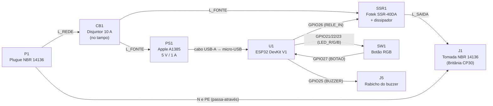
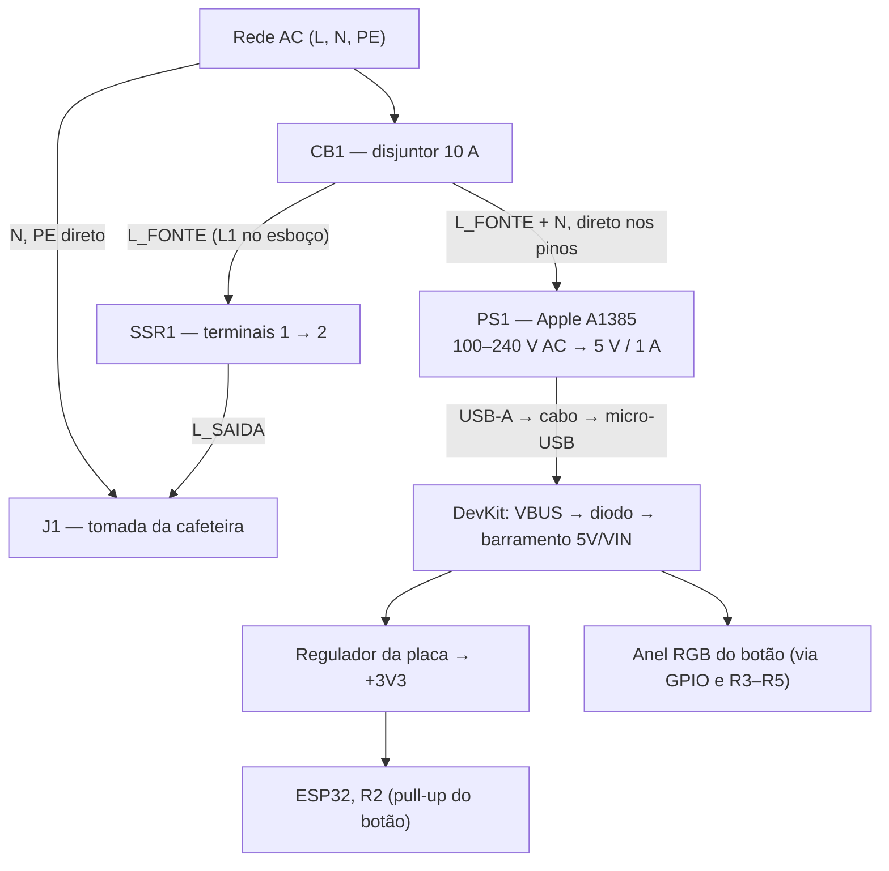

# Módulo de Hardware — Cafey

Documentação técnica do esquemático elétrico, da pinagem e da arquitetura elétrica do módulo IoT para a cafeteira Britânia CP30.

> **Revisão B (09/11/2026, #304).** Componentes da montagem de 10/11/2026: SSR Fotek SSR-40DA (#305), fonte Apple A1385 (#306), disjuntor de 10 A (#307), botão RGB (#308) e rabicho do buzzer (#311). A revisão A (HL-52S, HLK-PM01, fusível, LED RGB discreto) está resumida na seção 7.
>
> **Este documento é projeto, não instrução de ligação à rede.** Nenhuma montagem em tensão de rede antes das validações de #305, #306 e #307 e da validação por profissional habilitado (#19). Ver a seção 5.

---

## 1. Arquitetura e visão geral

O módulo intercala a alimentação da cafeteira e controla a passagem de energia para a tomada por um relé de estado sólido (SSR) comandado pelo ESP32. A interface física é um único botão com anel de LED RGB.

### Diagrama de blocos



### Diagrama de alimentação



- A proteção (CB1) fica **antes** do SSR e da derivação da fonte, a mesma filosofia do F1 da revisão A.
- O PE é passa-através do plugue até a tomada (borne J3). A carcaça é de PETG, sem massa metálica a aterrar.
- **Alimentação única:** o ESP32 é alimentado só pelo cabo USB. No esquemático, `+5V` representa o barramento 5V/VIN da placa, que recebe o VBUS do USB pelo diodo do DevKit. **Nada externo é ligado ao pino VIN**, e VIN e USB nunca alimentam a placa ao mesmo tempo (#306).
- **Tensão:** a CP30 é 127 V. O módulo só comuta a rede para a tomada, não converte tensão: um módulo bivolt não torna a cafeteira bivolt. Operação bivolt do conjunto só será declarada depois da validação elétrica (#19).

### Diagrama de conexões (fio a fio)

**Pendente.** Bitolas, emendas e bornes só serão desenhados depois de validar #305, #306 e #307, como pede a #304.

---

## 2. Esquemático KiCad (`hardware/`)

- Projeto: `hardware/pi_dsm_26_2.kicad_pro` (KiCad 10.0.x; última exportação com 10.0.7)
- Esquemático: `hardware/pi_dsm_26_2.kicad_sch` (revisão B+, 13/11/2026: folha A3)
- PDF vetorial: `hardware/pi_dsm_26_2.pdf`
- Bibliotecas locais: `hardware/libraries/` — `cafey.kicad_sym` traz os símbolos da revisão B (`SSR_DC_AC`, `Apple_A1385`, `Circuit_Breaker_1P`, `Botao_RGB`, `MOSFET_N_Logica`, `Boost_MT3608`, `DHT11_Modulo`). `relay_module.kicad_sym` fica como histórico da revisão A.

### Referências dos componentes

| Ref | Função | Modelo / especificação | Situação |
|---|---|---|---|
| **U1** | Microcontrolador | ESP32 DevKit V1 (30 pinos), removível (#309) | Em uso |
| **PS1** | Fonte 5 V | Apple A1385, 100–240 V AC → 5 V / 1 A, saída USB-A. Corpo ~38 × 25 × 25 mm (1,5 × 1 × 1 pol., informado em 09/11/2026), sem contar os pinos. Rede ligada direto nos pinos (decisão do responsável) | Em uso; verificações em #306 |
| **SSR1** | Acionamento da carga | Fotek SSR-40DA: entrada 3–32 V DC (3 = +, 4 = −), saída 24–380 V AC (1, 2), com dissipador aletado. Corpo **63 × 45 × 23 mm** (medido em 09/11/2026) | Em uso; dissipador, capacidade, fuga e ensaio térmico em #305 |
| **CB1** | Proteção contra sobrecorrente e liga/desliga geral | **Chave disjuntora ST-001**, 10 A, 125/250 V AC, reset/off, com LED vermelho, **3 terminais**, 29 × 14 × 25 mm (C × L × A), 9 g. Acesso pelo tampo | Pino 3 (lâmpada) ligado ao N no esquemático: **confirmar a marcação dos terminais na peça**. Recorte de painel e espessura máxima de painel a medir (#302). Capacidade de interrupção não informada (#307) |
| **SW1** | Interface física | Botão anti-vandalismo de aço inox, IP65, rosca 16 mm, frente 18 mm, 35 mm de comprimento, com chicote. **Contato 1NA** (fios amarelo e branco) → unidade A, GPIO27. **Anel RGB de ânodo comum** (`C+` = positivo comum em 12 V; `R`, `G`, `B` = cátodos, acesos ao puxar para o GND) → unidade B, via MOSFETs Q2–Q4, GPIO21/22/23. **LED especificado para 12–24 V DC** | Acionamento por MOSFETs no lado baixo, 12 V do U3 (seção 3.1). **Confirmar a polaridade com multímetro antes de energizar** (#308) |
| **J5** | Rabicho do buzzer | Conector destacável 2 vias (JST-XH): 1 = BUZZER (GPIO25), 2 = GND | O kit LAFVIN traz um buzzer ativo e um passivo (sem especificação elétrica no manual). Escolha e estágio de acionamento em #311 |
| **P1** | Entrada de energia | Cabo macho NBR 14136, 3G1,0 mm² (10 A) | Em uso |
| **J1** | Saída para a cafeteira | Tomada fêmea NBR 14136 de painel (10 A) | Em uso |
| **J3** | Junção do PE | Borne de aterramento DIN verde-amarelo / WAGO 221-412 | Em uso |
| **R1** | Pull-down da entrada do SSR | 10 kΩ, 1/4 W, de `RELE_IN` para GND: GPIO em alta impedância = SSR desligado | Em uso (era pull-up na rev. A) |
| **R2** | Pull-up do botão | 10 kΩ, 1/4 W | Em uso |
| **R3 / R4 / R5** | Resistores de gate de Q2–Q4 | 220 Ω, 1/4 W, em série entre o GPIO e o gate | Mudaram de função na rev. B+: eram limitadores do LED discreto |
| **R8 / R9 / R10** | Pull-down do gate | 10 kΩ, 1/4 W, do gate ao GND | Mantém o canal apagado com o GPIO em alta impedância (boot, reset, gravação) |
| **Q2 / Q3 / Q4** | Chave de cada canal do anel (R, G, B) | MOSFET canal N de nível lógico **IRLZ44N** (ou IRLIZ44N, com aba isolada), TO-220: G = GPIO, D = cátodo do canal, S = GND | Novo (rev. B+) |
| **U3** | Fonte de 12 V do anel | Módulo boost **MT3608** (ou XL6009), entrada no `+5V` (A1385), saída ajustada a **12,0 V** | Novo. Ajustar o trimpot com multímetro **antes** de ligar ao botão |
| **C4** | Reservatório do 12 V | Eletrolítico 100 µF / 25 V | Novo |
| **U4** | Sensor de temperatura e umidade | **DHT11**, módulo de 3 pinos do kit LAFVIN (VCC, DATA, GND; traz pull-up de 10 kΩ), em `+3V3` e GPIO33 | Novo. Exigência da prova (#323, ver seção 3.2) |
| **C1** | Reserva do barramento 5 V | Eletrolítico 470 µF / 16 V | Mantido da rev. A |
| **C2** | Desacoplamento do barramento 5 V | Cerâmico 100 nF | Mantido da rev. A |
| **C3** | Debounce do botão | Cerâmico 100 nF | Em uso |

Saíram do esquemático: **U2** (HLK-PM01, substituído por PS1), **F1** (fusível, substituído por CB1), **K3** (módulo relé HL-52S, substituído por SSR1) e **D1** (LED RGB discreto, agora unidade B de SW1). O conector USB de painel (M8) foi descartado (#309).

---

## 3. Pinagem (fonte única)

Esta tabela é a referência para o esquemático, o firmware e a documentação. A pinagem antiga deste arquivo (LED em GPIO32/33/25) estava errada: o esquemático e o firmware sempre usaram GPIO21/22/23.

| Sinal | GPIO | Pino DevKit | Direção | Polarização / componente | Firmware |
|---|---|---|---|---|---|
| `RELE_IN` (SSR1 +) | GPIO26 | 7 | Saída | R1 10 kΩ **pull-down**; nível ALTO liga a carga | `Relay`, `Cafeteira::kRelayActiveLevel = High` |
| `BOTAO` (SW1 A) | GPIO27 | 6 | Entrada | R2 10 kΩ pull-up + C3 100 nF; solto = 1, pressionado = 0 | `Cafeteira` (botão) |
| `LED_R` → Q2 | GPIO21 | 26 | Saída | R3 220 Ω → gate de Q2; R8 10 kΩ pull-down | `RgbLed` (nível alto acende) |
| `LED_G` → Q3 | GPIO22 | 29 | Saída | R4 220 Ω → gate de Q3; R9 10 kΩ pull-down | `RgbLed` |
| `LED_B` → Q4 | GPIO23 | 30 | Saída (LEDC) | R5 220 Ω → gate de Q4; R10 10 kΩ pull-down | `RgbLed` |
| `BUZZER` (J5.1) | GPIO25 | 8 | Saída (LEDC, se passivo) | Estágio a definir (#311) | Ainda não usado |
| `DHT_DATA` (U4) | GPIO33 | 9 | Entrada/saída (dreno aberto) | Pull-up de 10 kΩ no módulo (+ pull-up interno); sensor em +3V3 | `Dht11` + AO `Ambiente`, leitura a cada 5 s |
| `+5V` (barramento 5V/VIN) | VIN | 1 | Alimentação | Vem do USB (PS1). Nada externo neste pino | — |
| `+3V3` | 3V3 | 16 | Alimentação (`power_out`) | Regulador da placa; alimenta R2 | — |
| `+12V` | — | — | Alimentação | Saída do U3 (boost): só alimenta `C+` do anel (SW1 B) e C4 | — |
| `GND` | GND | 2, 17 | — | Comum DC **obrigatório entre PS1, U1, U3 (entrada e saída), Q2–Q4 e SSR1 −** | — |

### 3.1 Anel RGB do botão: 12 V por MOSFETs no lado baixo (#308)

O anel é de **12–24 V DC, ânodo comum**: `C+` recebe o positivo e cada cor acende
quando seu pino (`R`, `G` ou `B`) é puxado para o GND. O GPIO do ESP32 (3,3 V,
poucos mA) não aciona isso direto, então cada canal ganha um MOSFET:

```
GPIOxx ──[220 Ω]──┬── G
                  │        D ── pino R/G/B do botão
               [10 kΩ]     S ── GND comum
                  │
                 GND                     +12 V (U3) ── C+ do botão
```

- **Lógica sem inversão:** o MOSFET liga com o gate alto, então nível ALTO no GPIO
  acende o canal. O `RgbLed` segue com `common_anode = false`; a inversão de
  ânodo comum acontece no hardware, não no firmware.
- **MOSFET:** IRLZ44N (TO-220, conduz bem com 3,3 V no gate). O 2N7000 foi
  descartado: seu limiar chega a 3 V e ele só suporta 200 mA, o que deixa o
  acionamento a 3,3 V no limite. O AO3400 serve, mas é SMD e não entra na placa
  ilhada.
- **12 V:** módulo boost MT3608 (U3) na linha `+5V` da A1385 (1 A). O anel puxa
  algumas dezenas de mA, bem dentro da margem. **O trimpot sai de fábrica
  ajustado para tensões altas (até 28 V): ajustar para 12,0 V com multímetro,
  sem carga, antes de ligar ao botão.**
- **GND comum obrigatório** entre a fonte de 5 V, a entrada e a saída do boost,
  o ESP32 e as fontes dos MOSFETs. Sem ele os MOSFETs perdem a referência.
- **Pull-down do gate (R8–R10):** com o ESP32 resetando ou gravando, o GPIO fica
  em alta impedância; sem o resistor o gate flutua e o anel pisca.
- **A confirmar na bancada, sem rede:** (1) com o multímetro em modo diodo,
  confirmar que o fio preto é o positivo comum (ânodo). Se for cátodo comum, o
  circuito muda para chave no lado alto; (2) medir a corrente por cor a 12 V para
  saber se o anel já traz resistor interno. Se não trouxer, acrescentar um
  resistor em série em cada cátodo (para ~10 mA a 12 V: ~680 Ω no vermelho; os
  valores finais saem da medição).

### 3.2 DHT11: temperatura e umidade (GPIO33)

A prova exige leitura de temperatura. O DHT11 do kit (item 6 do inventário)
atende: 0–50 °C com ±2 °C e resolução de 1 °C; 20–80 % UR com ±5 %. Não serve
para medir o dissipador do SSR (queda de projeto: o #323 trata disso com outro
sensor); aqui mede **o ar dentro da carcaça**, que sobe com o SSR e é o dado
que o diagnóstico mostra.

- **Ligação:** VCC em `+3V3`, DATA no GPIO33, GND no comum. Em 3,3 V a linha de
  dado nunca passa de 3,3 V, então não precisa de conversor de nível. O módulo do
  kit traz o pull-up de 10 kΩ; com o sensor solto de 4 pinos, acrescentar 10 kΩ
  entre DATA e `+3V3`.
- **Por que GPIO33:** entrada e saída, sem função de strapping e sem sinal no boot.
- **Leitura:** a cada 5 s (o sensor pede ≥ 1 s). Cada leitura segura as
  interrupções por ~4 ms; com 5 s de intervalo isso não afeta Wi-Fi nem BLE.
- **Na carcaça:** o módulo fica por dentro da parede, a −140°, atrás de uma grade
  de furos de 2,5 mm, longe do SSR e do ESP32 (`mechanical/circular/aberturas.csv`).

**GPIO19 com defeito:** o GPIO19 do DevKit em uso não funciona. O projeto não o
usa; evitá-lo também em ESP32 de reposição, por precaução.

**Por que GPIO25 para o buzzer:** não é pino de strapping (0, 2, 5, 12, 15), não é somente entrada (34–39), não é a UART0 de gravação (1, 3) e não emite sinal no boot (como o GPIO14). Fica no mesmo lado do DevKit que GPIO26 e GPIO27, o que agrupa a fiação.

**Pinos evitados:** GPIO0, 2, 5, 12 e 15 (strapping; GPIO12 alto no boot impede a partida), GPIO1 e 3 (UART0), GPIO6–11 (flash), GPIO14 (sinal no boot) e GPIO34–39 (somente entrada).

---

## 4. Validação elétrica e relatório ERC

Verificação com `kicad-cli sch erc` (KiCad 10.0.7, 09/11/2026): **0 erros, 54 avisos**, todos esperados.

| Avisos | Tipo | Motivo |
|---|---|---|
| 20 | `pin_not_connected` | GPIOs livres do DevKit (eram 21; o GPIO25 passou a ser usado pelo buzzer) |
| 1 | `pin_to_pin` | U1.GND (bidirecional) × PS1.GND (saída de alimentação). Mesmo caso da rev. A com U2.−Vout: a fonte define a referência zero |
| 1 | `same_local_global_label` | Rótulo local `Earth_Protective` × símbolo de alimentação de mesmo nome. Herdado da rev. A, intencional (nó do PE) |
| 32 | `lib_symbol_issues` | Só em máquina sem as bibliotecas padrão do KiCad configuradas (`power`, `Device`, `Connector`, `Connector_Generic`). Os símbolos estão embutidos no esquemático; com as bibliotecas instaladas, o aviso some |

Netlist conferida nó a nó (`kicad-cli sch export netlist`):

| Rede | Nós |
|---|---|
| `L_REDE` | P1.L, CB1.1 |
| `L_FONTE` | CB1.2, PS1.AC/L, SSR1.1 (T1) |
| `L_SAIDA` | SSR1.2 (T2), J1.L |
| `N` | P1.N, PS1.AC/N, J1.N, CB1.3 (lâmpada) |
| `Earth_Protective` | P1.PE, J1.PE, J3 |
| `RELE_IN` | U1.GPIO26, SSR1.3 (+), R1 |
| `GND` | U1.GND (2, 17), PS1.GND, SSR1.4 (−), R1, SW1.2, SW1.K, C1, C2, C3, J5.2 |
| `+5V` | U1.VIN, PS1.VBUS, C1, C2 |
| `+3V3` | U1.3V3, R2 |
| `BOTAO` | U1.GPIO27, SW1.1, R2, C3 |
| `LED_R/G/B` | U1.GPIO21/22/23 → R3/R4/R5 → SW1.RA/GA/BA |
| `BUZZER` | U1.GPIO25, J5.1 |

### Comandos

```sh
kicad-cli sch erc hardware/pi_dsm_26_2.kicad_sch
kicad-cli sch export pdf -o hardware/pi_dsm_26_2.pdf hardware/pi_dsm_26_2.kicad_sch
kicad-cli sch export netlist -o hardware/pi_dsm_26_2.net hardware/pi_dsm_26_2.kicad_sch
```

---

## 5. Segurança elétrica — pendências

O esboço manuscrito do responsável (08/11/2026) foi o ponto de partida, **não** um esquemático validado. Status de cada verificação da #304:

| Verificação | Status | Onde |
|---|---|---|
| Autenticidade do SSR | Confirmada pelo responsável (08/11/2026) | #305 |
| Especificações da unidade SSR registradas (etiqueta) | Pendente | #305 |
| Capacidade do SSR para a carga real (~6,3 A em 127 V), com curva de redução | Pendente | #305 |
| Dissipação térmica e dissipador (estimativa ~8–10 W durante o preparo) | Pendente — ensaio térmico de 10/11/2026 | #305 |
| Corrente de fuga do SSR desligado e modo de falha (curto) | Pendente. Desligar pelo app **não** secciona a rede | #305 |
| Acionamento direto pelo GPIO (3,3 V contra mínimo de 3 V) | Pendente — medir na bancada | #305 |
| Dimensionamento do disjuntor e dos condutores | ST-001 10 A para a carga de ~6,3 A: margem adequada em regime. Condutores de 1,0 mm² (cabo) e 1,5 mm² (interno) compatíveis com 10 A. Falta a curva de disparo | #307 |
| Proteção contra sobrecorrente (breaker protege a fiação num curto do SSR) | **Pendente, com ressalva.** O ST-001 é uma chave disjuntora compacta, provavelmente térmica (bimetal), e o anúncio não informa a capacidade de interrupção. Ela protege contra sobrecarga; contra curto-circuito, a proteção principal passa a ser o disjuntor da instalação. Levar ao profissional (#19) | #307, #19 |
| Isolamento entre baixa tensão e rede | Pendente — separação física na carcaça | #302 |
| Distâncias de isolamento e de escoamento | Pendente | #302, #19 |
| Aterramento (PE passa-através) e carcaça plástica | Projetado (J3); verificar na montagem | #19 |
| Isolamento físico da entrada de alimentação | Pendente | #302 |
| Integração do A1385 com ligação direta nos pinos | Decisão do responsável; verificações pendentes | #306 |
| Operação bivolt | Não declarada. Só depois da validação do conjunto | #19 |

A classificação de 40 A do SSR não significa que seja necessário ou seguro usar essa corrente.

---

## 6. Firmware

O firmware segue a pinagem da seção 3. A polaridade do SSR está em `Cafeteira::kRelayActiveLevel` (`firmware/main/app/cafeteira.hpp`). **O firmware atual não pode rodar com o módulo HL-52S ligado ao GPIO26:** o repouso do active-high (nível BAIXO) liga o HL-52S.

---

## 7. Revisão A (histórico)

Até 08/11/2026, o caminho da carga era `P1 → F1 (fusível 10 A T) → K3 (HL-52S, COM/NO, active-low) → J1`, com U2 (HLK-PM01) alimentando o VIN, R1 como pull-up para +3V3, LED RGB discreto D1 e botão M1. O esquemático, o PDF e este README dessa revisão estão no histórico do Git (commit `f5c82fb`).
