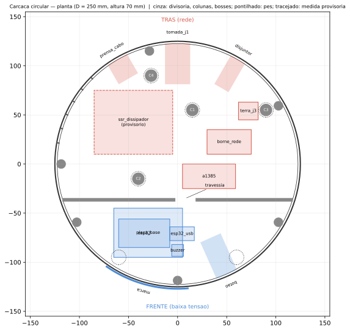

# Carcaça circular (#302)

Revisão da carcaça para a montagem de 10/11/2026: **laterais circulares, base e topo planos, pés de borracha** (decisão do responsável, 09/11/2026). A cafeteira Britânia CP30 fica apoiada no tampo.



## Como gerar

```sh
python3 mechanical/circular/check.py           # verificação do layout (segundos, sem FreeCAD)
freecadcmd mechanical/circular/build.py        # corpo e fundo: STL, STEP do conjunto e FCStd
uv run mechanical/circular/marca.py            # grava a marca na parede -> corpo.stl
uv run mechanical/circular/planta.py           # atualiza planta.svg
freecad mechanical/circular/visualizar.py      # abre no FreeCAD com cores -> arranjo_circular.FCStd
# sem abrir janela: CAFEY_FECHAR=1 QT_QPA_PLATFORM=offscreen freecad mechanical/circular/visualizar.py
```

Saídas em `mechanical/build/circular/` (não versionada):

| Arquivo | O que é |
|---|---|
| `corpo.stl` | **Peça 1, para imprimir:** tampo, parede, divisória, colunas, bosses e marca gravada |
| `fundo.stl` | **Peça 2, para imprimir:** fundo removível, berço da placa, berço da fonte e ventilação |
| `carcaca.step` | Conjunto: corpo + fundo + volumes de referência dos componentes (sem a marca) |
| `carcaca.FCStd` | O mesmo conjunto, para abrir no FreeCAD |
| `arranjo_circular.FCStd` | **Para visualizar:** conjunto agrupado e colorido, com os **modelos 3D** de `mechanical/models/` no lugar das caixas (ESP32, botão, tomada, prensa-cabo, A1385, SSR, 2 × WAGO 221-413, borne de terra DIN, buzzer), mais a chave ST-001 simplificada e o dissipador **provisório** (laranja), gerados pelo script. Componentes sem modelo ficam como caixa: baixa tensão em azul, rede em vermelho, provisório em laranja. Gerado pelo `visualizar.py` (tabela `MODELOS`) |
| `corpo_sem_marca.stl` | Intermediário do `build.py` |

**Toolchain:** FreeCAD 1.x (API `Part`, por script) é a fonte da verdade da geometria. A marca é gravada sobre a malha com `manifold3d`, porque enrolar a composição no cilindro com profundidade constante é direto em malha e trabalhoso em B-rep. Por isso o STEP não traz a marca, e o STL traz.

## Fonte editável

Tudo é dirigido por três CSVs, lidos por `layout.py`, que é compartilhado entre a verificação e o build:

| Arquivo | Conteúdo |
|---|---|
| `parametros.csv` | Diâmetro, altura, espessuras, divisória, bosses, colunas, pés, ventilação, marca, berços e critérios |
| `componentes.csv` | Volumes internos (caixas). O `z` é relativo ao piso, então mudar a altura não desloca os componentes |
| `aberturas.csv` | Recortes na parede (ângulo, altura, tamanho) e o volume do componente por dentro |

Coordenadas: origem no centro da face superior do tampo, corpo em z < 0. **Frente = −90° (y < 0), traseira = +90° (y > 0).**

## Arranjo

| Região | O que tem |
|---|---|
| **Frente (baixa tensão)** | Marca gravada a −105°, botão RGB a −66° e buzzer a −45°, encostado na parede atrás de 7 furos de 2,5 mm para o som sair. Placa base com o ESP32 nos soquetes, num berço de trilhos sobre o fundo |
| **Divisória** | Corda em y = −36,5, impressa junto com o corpo, do tampo até 0,3 mm do fundo. Passagem de fios de 20 × 12 mm na base (cabo USB da fonte e os 2 fios da entrada do SSR) |
| **Traseira (rede)** | Tomada J1 a 90°, chave disjuntora a 60° (na parede, decisão de 09/11), prensa-cabo a 120°. SSR com dissipador perto da parede esquerda-traseira, com rasgos de ventilação na parede (135° a 170°, fileira baixa e alta) e no fundo. A1385 num berço com abraçadeira. Bornes e borne de terra |

**Estrutura:** a carga da cafeteira desce do tampo pelas 4 colunas e pela divisória até o fundo, e de lá para os pés. Há um pé logo abaixo de cada coluna e dois na frente. As colunas não têm parafuso. O fundo é preso por 6 parafusos M3 em insertos térmicos nos bosses da parede.

## Verificação (`check.py`)

Confere:
- se as peças cabem na impressora;
- se os componentes ficam dentro do cilindro e entre o piso e o tampo;
- a separação rede/baixa tensão (componentes de rede a ≥ 8 mm da divisória);
- colisões entre componentes, corpos das aberturas, colunas, bosses e divisória (folga de 2 mm);
- margens dos recortes em relação ao tampo, ao piso e entre si ao longo da parede;
- se os pés ficam longe dos parafusos;
- a **flecha do tampo**.

A flecha é estimada como o maior círculo sem apoio, tratado como placa apoiada (Roark), com 3 kgf e fluência × 4. Hoje dá **0,29 mm contra o limite de 0,34 mm (L/300)**, ignorando a rigidez das nervuras. É uma estimativa analítica, não FEA nem ensaio.

## Medidas provisórias: o que fazer amanhã

| Item | Hoje | Como atualizar |
|---|---|---|
| **Dissipador do SSR** | `ssr_dissipador` 80 × 65 × 50 mm, chutado | Medir o SSR montado no dissipador, com as aletas na vertical. Atualizar `dx, dy, dz` (e `x, y`, se precisar) em `componentes.csv`. Se o topo passar do tampo, o `check.py` acusa: aumentar `altura_externa` em `parametros.csv` |
| **Recorte do disjuntor** | 13 × 28 mm | Medir o recorte de painel do ST-001 e corrigir `largura` e `altura` da linha `disjuntor` em `aberturas.csv` |
| Impressora | 260 mm de mesa | Corrigir `impressora_xy`. O diâmetro precisa ser no máximo a mesa − 5 mm |

Depois de mudar qualquer CSV: `check.py` → `build.py` → `marca.py`.

## Montagem

- **Impressão:** o corpo sai **de cabeça para baixo** (tampo na mesa), sem suporte, porque parede, divisória, colunas e bosses crescem a partir do tampo. O fundo sai com os berços para cima.
- **Insertos:** 6 insertos M3 × 5,7 nos bosses (furo de 4,0 mm, fundidos a quente). Parafusos M3 por baixo, com a cabeça rebaixada no fundo.
- **SSR e dissipador:** a furação depende do dissipador. Posicionar sobre o fundo, marcar e furar o PETG. O dissipador **não encosta no PETG**: usar espaçadores (#305).
- **A1385:** entre as paredes do berço, presa com abraçadeira pelos rasgos do fundo.
- **Placa base (perfurada 5 × 7 cm):** corre nas ranhuras dos trilhos até o batente. O ESP32 encaixa nos soquetes fêmea e sai puxando, sem ferramenta (#309).
- **Pés de borracha:** nos assentos rasos do fundo, sob as colunas e na frente.

## Limitações conhecidas

- O dissipador e a altura são provisórios. É a maior incerteza.
- A tomada J1 está na vertical (recorte de 23 × 45,5 mm). Na parede curva, a flange plana (25 a 28 mm de largura) fica 0,6 a 0,8 mm afastada da parede no centro. Se incomodar, calçar ou lixar.
- A ventilação foi posicionada, mas não dimensionada. O ensaio térmico de 10/11 (#305) decide se basta.
- O posicionamento do SSR no fundo e a fixação dos bornes ficam para a montagem (furação manual).
- O modelo retangular (`mechanical/scripts/*_3d.py`, `mechanical/cad/`) fica como histórico.
